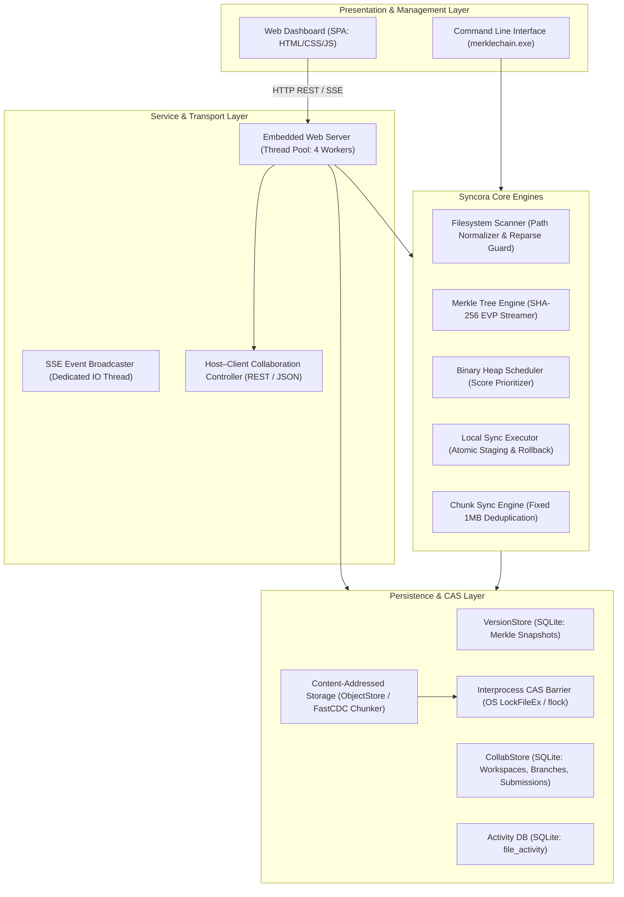
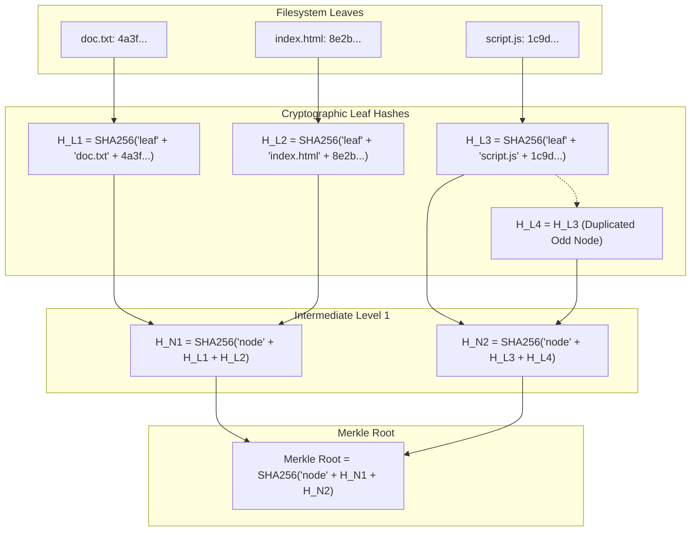
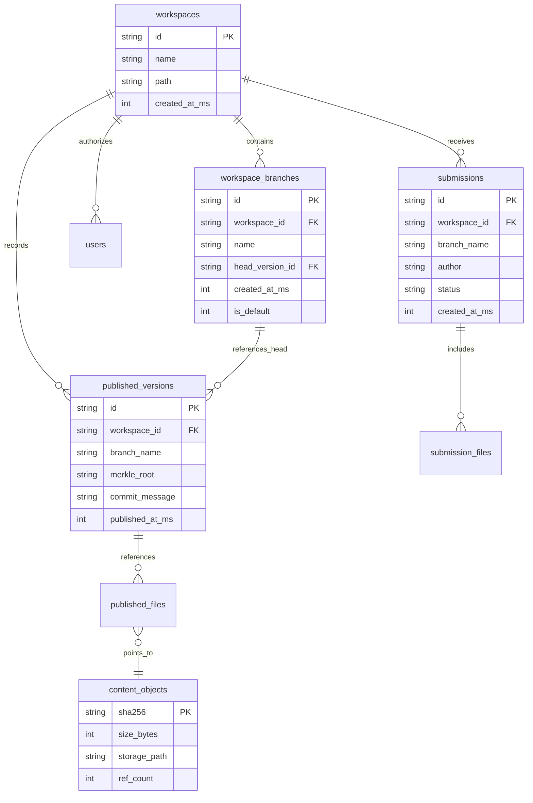

# SYNCORA: ARCHITECTURAL & TECHNICAL SPECIFICATION
## High-Performance Merkle-Tree Cryptographic File Synchronization, Content-Addressed Versioning & Host–Client Collaboration System

---

## Document Control & Metadata

| Property | Value |
| :--- | :--- |
| **System Name** | **Syncora** (Executable: `merklechain.exe`, Namespace: `merklechain`) |
| **Document Version** | `1.1.0` (Production Reference for Milestone 3.5 Stage 2) |
| **Target Audience** | Software Engineers, Systems Architects, Technical Evaluators, Students |
| **Primary Repository** | `https://github.com/aayush15-it/Syncora.git` |
| **Source of Truth** | Verified repository source code (`include/`, `src/`, `web/`, `tests/`) |
| **Classification** | Comprehensive Technical System Documentation |

---

## Table of Contents

1. [Project Overview](#1-project-overview)
2. [Problem Statement & Engineering Motivation](#2-problem-statement--engineering-motivation)
3. [Project Objectives](#3-project-objectives)
4. [Technology Stack & Systems Dependencies](#4-technology-stack--systems-dependencies)
5. [Overall System Architecture](#5-overall-system-architecture)
6. [Operational Synchronization Models](#6-operational-synchronization-models)
7. [Detailed Module-Wise Architectural Breakdown](#7-detailed-module-wise-architectural-breakdown)
8. [Core Algorithms & Data Structures](#8-core-algorithms--data-structures)
9. [Merkle Tree Implementation & Data Integrity Model](#9-merkle-tree-implementation--data-integrity-model)
10. [Chunk Synchronization, FastCDC & Content-Addressed Storage (CAS)](#10-chunk-synchronization-fastcdc--content-addressed-storage-cas)
11. [Database Schema, Persistence & Concurrency Design](#11-database-schema-persistence--concurrency-design)
12. [Network Collaboration Architecture & Security Model](#12-network-collaboration-architecture--security-model)
13. [Embedded Web Server, REST API & Server-Sent Events (SSE)](#13-embedded-web-server-rest-api--server-sent-events-sse)
14. [Frontend Dashboard Architecture & UI Modules](#14-frontend-dashboard-architecture--ui-modules)
15. [Complete Project Directory Structure](#15-complete-project-directory-structure)
16. [Build Pipeline, Toolchain & Execution Instructions](#16-build-pipeline-toolchain--execution-instructions)
17. [Testing Framework, Test Suites & Verification Evidence](#17-testing-framework-test-suites--verification-evidence)
18. [Security Engineering, Reliability & Fault-Tolerance](#18-security-engineering-reliability--fault-tolerance)
19. [Architectural Evolution: Transition from P2P to Host–Client Model](#19-architectural-evolution-transition-from-p2p-to-hostclient-model)
20. [Current Implementation & Verification Status Matrix](#20-current-implementation--verification-status-matrix)
21. [Known Architectural Boundaries & Future Roadmap](#21-known-architectural-boundaries--future-roadmap)
22. [End-to-End Walkthrough: Syncora in Action](#22-end-to-end-walkthrough-syncora-in-action)
23. [Technical Glossary](#23-technical-glossary)

---

## 1. Project Overview

### 1.1 Executive Summary
**Syncora** is an enterprise-grade, high-performance C++17 system engineered for deterministic, cryptographically verifiable file synchronization, content-addressed version control, and multi-user workspace collaboration. At its core, Syncora utilizes **Merkle Trees** (cryptographic hash trees) and **OpenSSL SHA-256** streaming digests to detect folder divergence in $O(\log N)$ or $O(K)$ time (where $K$ is the number of mutated files) rather than re-reading and transmitting entire folder trees.

Syncora bridges the gap between conventional file-copy utilities (which lack integrity proofs, deduplication, and crash resilience) and complex distributed version control systems (like Git, which require manual staging, committing, and external hosting). Syncora features an embedded multi-threaded HTTP server, dynamic Server-Sent Events (SSE) broadcasting, an interactive single-page dashboard with real-time algorithm visualizers, an OS-level locking Content-Addressed Storage (CAS) engine with FastCDC chunking, and a robust **Host–Client Collaboration Network Model**.

### 1.2 The Problem It Solves
Traditional folder synchronization mechanisms face critical vulnerabilities:
1. **Inefficient Comparison**: Naive synchronizers inspect modification timestamps ($mtime$) or file sizes, both of which can be spoofed, altered across filesystems, or desynchronized by daylight savings. Deep comparison without cryptographic trees forces exhaustive $O(N)$ disk I/O.
2. **Silent Data Corruption (Bit Rot)**: File transfers over network links or faulty disks frequently experience byte flips. Without cryptographic block validation, corrupted files overwrite valid targets permanently.
3. **Destructive Partial Transfers**: A network disconnection or power loss mid-sync can leave files half-written, rendering application files and source code broken.
4. **Massive Redundancy in Small Edits**: Editing a single line in a 500 MB database or media file typically forces re-uploading the entire 500 MB.
5. **Concurrency Hazards**: Multiple processes reading and writing shared object stores lead to corrupt headers, partial writes, and broken index tables.

Syncora eliminates these failure modes using:
- **Lexicographically sorted binary Merkle Trees** for instantaneous divergence localization.
- **Fail-safe, two-phase atomic staging and rename commits** with automated rollback journals.
- **Content-Defined Chunking (FastCDC)** and **fixed 1 MB chunk deduplication**.
- **Interprocess kernel-level lock barriers** (`LockFileEx` / `flock`) that enter fail-closed poisoned states upon OS-level unlock violations.

### 1.3 Key Operational Capabilities
Syncora is structured around two distinct, active operational models:
1. **Local Workspace Model**: Synchronizes two local folders directly, performs bidirectional diffing, stages files atomically, backs up existing targets, and prevents accidental deletions.
2. **Network Collaboration Model (Host–Client)**: Provides centralized team collaboration where a central Host manages workspaces and branch histories, while distributed Clients check out working copies, create proposals, submit changes for host review, and pull immutable published updates.

---

## 2. Problem Statement & Engineering Motivation

### 2.1 The Limits of Basic File Copy Utilities
Utilities such as `cp`, `robocopy`, and standard cloud sync clients often compare files via basic filesystem metadata:
$$\text{Metadata Check} = (size_A == size_B) \land (mtime_A == mtime_B)$$
This approach breaks down under several conditions:
- **Timestamp Drift**: FAT32 has a 2-second timestamp resolution; NTFS has 100-nanosecond resolution; Linux ext4 has nanosecond resolution. Moving files across filesystems causes false positives.
- **Content Modification Without Size Change**: Replacing strings of identical length or in-place binary patch updates leaves file size unchanged while contents diverge completely.
- **Lack of Nonce/Root Verification**: A recipient has no mathematical proof that the received folder state exactly matches the sender's folder state without a cryptographic root hash.

### 2.2 Syncora's Cryptographic Solution
Syncora enforces cryptographic invariants across all tiers:
1. Every file has an immutable SHA-256 content digest calculated via streaming buffers:
   $$H_{file} = \text{SHA-256}(B_1 \parallel B_2 \parallel \dots \parallel B_m)$$
2. Every directory tree has a deterministically ordered Merkle Root:
   $$H_{leaf} = \text{SHA-256}(\text{"leaf"} \parallel \text{relative\_path} \parallel H_{file})$$
   $$H_{parent} = \text{SHA-256}(\text{"node"} \parallel H_{left} \parallel H_{right})$$
3. A single 32-byte hash comparison between two folders proves absolute byte-for-byte identity. If roots match, synchronization terminates immediately in $O(1)$ operations.

---

## 3. Project Objectives

### 3.1 Technical Goals
- **Strict Cryptographic Determinism**: Ensure reproducible Merkle roots across Windows, Linux, and macOS by enforcing lexicographical sorting and unified forward-slash path normalization.
- **Zero-Data-Loss Atomic Mutations**: Ensure destination files are never touched directly during transfer. Operations write to staging files, verify hashes, preserve old files into a recovery backup tree, and swap atomically.
- **Fault-Tolerant Concurrent Storage**: Build a Content-Addressed Storage (CAS) engine safe against multiple concurrent processes using cross-process kernel file locks and RAII guards.
- **Bounded Embedded Footprint**: Implement an in-memory HTTP server and SQLite persistent storage without heavy third-party web frameworks, running with minimal memory overhead.

### 3.2 Functional Goals
- Provide both a command-line interface (CLI) for headless automation and an interactive web GUI for intuitive user operation.
- Provide interactive visualizers for computer science education, illustrating Merkle tree node reduction, FastCDC rolling hash boundaries, and priority heap scheduling.
- Support multi-branch workflows (`main`, feature branches) within collaborative workspaces.

---

## 4. Technology Stack & Systems Dependencies

| Component | Technology / Library | Version / Standard | Purpose in Syncora |
| :--- | :--- | :--- | :--- |
| **Core Language** | C++ | C++17 (`-std=c++17`) | Strong typing, RAII, `std::filesystem`, structured concurrency |
| **Cryptography** | OpenSSL (libcrypto & libssl) | 3.5.2+ | Streaming SHA-256 (`EVP_Digest*`), TLS sessions, X.509 cert handling |
| **Database Engine** | SQLite3 | 3.50.4 (Amalgamation) | Embedded metadata persistence: activity logs, version store, collab store |
| **OS Networking** | Windows Sockets (Winsock2) / POSIX Sockets | `Ws2_32.lib` / `<sys/socket.h>` | Low-level TCP stream sockets, non-blocking polling (`select`/`poll`) |
| **Kernel Synchronization**| Win32 API / POSIX Kernel | `LockFileEx` / `flock` | Cross-process CAS barriers, file locks, atomic rename (`MoveFileExW`) |
| **Build System** | GNU Make / MinGW-w64 GCC | GCC 15.2.0 (UCRT64) / Make 4.4.1 | Optimized compilation, static linking options, test harness runner |
| **Frontend UI** | HTML5 / CSS3 / Vanilla JavaScript | ES6+ (No external JS frameworks) | Single-Page Application (SPA), SSE streaming, SVG/DOM tree visualizers |
| **Automation** | PowerShell / Bash | PS 5.1+ / MSYS2 UCRT64 | Diagnostic scripts, dashboard runners (`run-dashboard.ps1`), CI test runners |

---

## 5. Overall System Architecture

Syncora is structured into modular layers with clear separation of concerns:



---

## 6. Operational Synchronization Models

Syncora provides two primary operational modes accessible directly from the landing dashboard:

### 6.1 Mode 1: Local Workspace Synchronization
Designed for syncing two directories on the same system (e.g., project folder to an external backup SSD, or between two local drives):
1. **Directory Traversal**: The `Scanner` crawls source folder $A$ and destination folder $B$, rejecting symlinks, directory junctions, and NTFS reparse points.
2. **Manifest Generation**: Generates `FolderManifest` objects containing lexicographically sorted `FileRecord` entries.
3. **Merkle Comparison**:
   - If `merkle_root(A) == merkle_root(B)`, folders are identical; sync finishes with zero mutations.
   - If roots differ, `compare_manifests(A, B)` classifies files into:
     - `Add`: File exists in $A$ but not $B$.
     - `Modify`: File exists in both but hashes differ.
     - `Unchanged`: File exists in both and hashes match.
     - `Preserve`: File exists in $B$ but not $A$.
4. **Non-Destructive Invariant**: Syncora **never** deletes files in destination $B$ implicitly. Unmatched files are marked `Preserve` to prevent accidental data loss.
5. **Atomic Execution**: Changes are staged to `.merklechain-tmp-<job_id>`, verified, backed up to `.merklechain/recovery/`, and committed atomically via filesystem renames.

### 6.2 Mode 2: Network Model (Host–Client Collaboration)
Designed for coordinated multi-user team collaboration across network boundaries:
1. **Host Repository**: A designated central host maintains a repository with branches (`workspace_branches`), managed through `CollabStore`.
2. **Working Copies**: Authorized clients check out an isolated working copy of the workspace.
3. **Branching Model**: Workspaces support multiple named branches (e.g., `main`, `feature-ui`). The active branch points to an immutable published version.
4. **Submission Pipeline**:
   - Clients create submissions containing added, modified, or deleted files.
   - Submissions enter `PENDING` status for host review.
5. **Host Review & Approval**: The host reviews file diffs in the dashboard. Upon approval, the submission is accepted and published to the target branch.
6. **Immutable Published Versions**: Each accepted submission commits an immutable version into the Content-Addressed Storage (CAS) engine.
7. **Dirty Working-Copy Protection**: When switching branches (`/api/collab/branches/switch`), Syncora audits local working files. If uncommitted changes exist, the switch is rejected unless explicitly forced, preventing data loss.

---

## 7. Detailed Module-Wise Architectural Breakdown

### 7.1 Core Hash Engine (`include/merklechain/hash.hpp`, `src/hash.cpp`)
- **Primary Function**: `sha256_file(const fs::path& path)`
- **Implementation**: Uses OpenSSL `EVP_MD_CTX` with `EVP_sha256()`. Streams file contents in chunks of **1,048,576 bytes (1 MB)** to bound resident memory usage regardless of file size.
- **String Hashing**: `sha256_string(std::string_view data)` formats the output as a 64-character lowercase hexadecimal string.
- **Path Digest**: `hash_path(const fs::path& path)` provides a cryptographic digest of normalized path strings.

### 7.2 Merkle Tree Engine (`include/merklechain/hash.hpp`, `src/hash.cpp`)
- **Primary Function**: `merkle_root(const FolderManifest& manifest)`
- **Implementation**:
  - Empty manifest check: If empty, returns `sha256_string("MERKLECHAIN-EMPTY-v1")`.
  - Sorts all records strictly by `relative_path` in ascending ASCII order.
  - Generates leaf hashes: `sha256("leaf" + rel_path + file_sha256)`.
  - Iteratively pairs nodes: `sha256("node" + left_hash + right_hash)`.
  - Handles odd node counts by duplicating the final node at the current tree level.
- **Inspection Support**: `build_merkle_tree_info(const FolderManifest& manifest)` constructs the complete tree hierarchy (`MerkleTreeInfo`, `MerkleLevelInfo`, `MerkleLeafInfo`) for rendering in the Web UI.

### 7.3 Filesystem Scanner (`include/merklechain/scanner.hpp`, `src/scanner.cpp`)
- **Primary Function**: `scan_folder(const fs::path& root_path)`
- **Path Sanitization**: `safe_relative_path(const fs::path& root, const fs::path& target)` rejects directory traversals (`..`), drive letters (`C:`), null bytes, and Windows reserved device names (`CON`, `PRN`, `AUX`, `NUL`, `COM1-9`, `LPT1-9`).
- **Reparse Guard**: On Windows, calls `GetFileAttributesW` to detect and skip `FILE_ATTRIBUTE_REPARSE_POINT` (symlinks, directory junctions, volume mount points), mitigating infinite recursive loops.
- **Excluded Directories**: Automatically ignores `.merklechain`, `.git`, `.syncora_op_sentinel`, and temporary files.

### 7.4 Staging & Atomic File Operations (`include/merklechain/staging_file.hpp`, `src/staging_file.cpp`)
- **Primary Class**: `StagingFile`
- **Workflow**:
  1. Opens a temporary staging file: `<dest>/.merklechain-tmp-<job_id>`.
  2. Writes incoming bytes and continuously updates an internal SHA-256 digest.
  3. Verifies that written hash matches the manifest hash.
  4. If destination file exists, moves it to `.merklechain/recovery/<rel_path>.<job_id>`.
  5. Atomically renames staging file to final destination path using `MoveFileExW` with `MOVEFILE_REPLACE_EXISTING` (or POSIX `rename`).
  6. On error, automatically restores the backup file from recovery and unlinks the staging file.

### 7.5 Binary Heap Scheduler (`include/merklechain/scheduler.hpp`, `src/scheduler.cpp`)
- **Primary Class**: `BinaryHeapScheduler`
- **Underlying Structure**: Max-binary heap implemented via `std::vector<SyncJob>` and `std::push_heap`/`std::pop_heap`.
- **Dynamic Scoring**: Computes job priority using the formula:
  $$\text{Score} = \text{BaseScore} + \min(\lfloor \text{size} / 1\text{MB} \rfloor, 1000) + \text{RecencyBonus} + \text{AgingBonus}$$
  - $\text{BaseScore}$: `Add` = 400, `Modify` = 300, `Delete` = 200, `Unchanged/Preserve` = 0.
  - $\text{RecencyBonus}$: Up to +120 points for files modified within the past 2 hours.
  - $\text{AgingBonus}$: +1 point per minute a job remains unexecuted in the queue (starvation prevention).
- **Authorization Guard**: Dequeue operations require a valid `SchedulerAuthorization` token, enforcing explicit lifecycle control.

### 7.6 Fixed Chunk Sync Engine (`include/merklechain/chunk_sync.hpp`, `src/chunk_sync.cpp`)
- **Constants**: `kDefaultChunkSize = 1,048,576` (1 MB), `kMaxDeduplicationWindow = 128 MB`.
- **Primary Function**: `generate_chunk_manifest(const fs::path& file_path)`
- **Deduplication Logic**: When updating a modified file, computes hashes of all 1 MB blocks in both source and destination. If destination already contains a matching chunk at any offset, that chunk is copied locally rather than re-transmitted or re-read across the network.

### 7.7 Content-Addressed Storage & FastCDC (`include/merklechain/cas/`)
- **FastCDC Chunker** (`chunker.cpp`): Implements variable-size Content-Defined Chunking using a 256-entry Gear hash matrix and dual-mask normalization.
  - `min_size = 4,096` bytes (4 KB).
  - `avg_size = 16,384` bytes (16 KB).
  - `max_size = 65,536` bytes (64 KB).
- **Object Store** (`object_store.cpp`): Stores chunks in a content-addressed directory sharded by the first two hexadecimal characters of their SHA-256 hash (`objects/ab/cdef...`).
- **Interprocess CAS Barrier** (`interprocess_barrier.hpp`): Provides cross-process file-locking synchronization (`LockFileEx` on Windows, `flock` on POSIX). Features fail-closed poison semantics: if an unlock operation fails at the OS syscall level, the barrier poisons itself to prevent undetected race conditions.

### 7.8 Local Activity Database (`include/merklechain/activity_db.hpp`, `src/activity_db.cpp`)
- **Database Path**: `.merklechain/activity.sqlite3`
- **Table**: `file_activity`
- **Schema**:
  ```sql
  CREATE TABLE IF NOT EXISTS file_activity (
      id INTEGER PRIMARY KEY AUTOINCREMENT,
      timestamp INTEGER NOT NULL,
      job_id INTEGER NOT NULL,
      file_path TEXT NOT NULL,
      action TEXT NOT NULL,
      status TEXT NOT NULL,
      source_hash TEXT,
      dest_hash TEXT,
      bytes_transferred INTEGER NOT NULL,
      error_message TEXT
  );
  ```
- **Thread Safety**: Access guarded via `std::mutex db_mutex_` and SQLite write-ahead logging (WAL) mode.

### 7.9 Version Store (`include/merklechain/version_store.hpp`, `src/version_store.cpp`)
- **Database Path**: `.merklechain/versions.sqlite3`
- **Tables**:
  - `content_objects`: Tracks SHA-256 content hashes, payload sizes, storage paths, and reference counts.
  - `version_records`: Stores snapshot metadata (version ID, timestamp, Merkle root, message, author).
  - `version_files`: Maps version records to content objects and relative file paths.
  - `restore_journal`: Logs rollback transactions for disaster recovery.
- **Automated Ref-Counting**: SQLite database triggers (`trg_inc_ref`, `trg_dec_ref`) automatically maintain `ref_count` when version files are added or removed.

### 7.10 Collaborative Store (`include/merklechain/collab_store.hpp`, `src/collab_store.cpp`)
- **Database Path**: Central workspace SQLite repository.
- **Core Entities**:
  - `workspaces`: Registered collaboration projects.
  - `workspace_branches`: Multi-branch tracking (`id`, `workspace_id`, `name`, `head_version_id`, `created_at_ms`, `is_default`).
  - `users` & `sessions`: Authentication tokens, roles (`OWNER`, `CONTRIBUTOR`, `VIEWER`), and session expiration.
  - `submissions` & `submission_files`: Proposals submitted by clients pending host review.
  - `published_versions` & `published_files`: Accepted versions committed to the central branch history.
  - `workspace_operations`: High-concurrency atomic counter enforcing monotonic version progression.

### 7.11 Embedded Web Server & SSE Broadcaster (`include/merklechain/web_server.hpp`, `src/web_server.cpp`)
- **Concurrency Model**: Master listener socket on port 47831 (or user-specified port) with a bounded worker pool of 4 worker threads.
- **I/O Polling**: Uses non-blocking socket loops with 100ms `select()` timeouts to ensure rapid response to shutdown signals.
- **Server-Sent Events (SSE)**: Managed by `EventBroadcaster` on a dedicated I/O thread. Maintains a thread-safe list of active subscriber sockets. When a sync, submission, or branch event occurs, JSON-formatted SSE events are pushed asynchronously to all open browsers.

---

## 8. Core Algorithms & Data Structures

### 8.1 SHA-256 Streaming Algorithm
To hash arbitrarily large files without exceeding physical RAM limits, Syncora uses an iterative streaming block buffer:

```
Algorithm 1: sha256_file(path)
Input: Filesystem path to target file
Output: 64-character lowercase hexadecimal SHA-256 string

1.  ctx = EVP_MD_CTX_new()
2.  EVP_DigestInit_ex(ctx, EVP_sha256(), NULL)
3.  stream = open_binary_ifstream(path)
4.  buffer = allocate_bytes(1,048,576)  // 1 MB buffer
5.  while stream has bytes remaining:
6.      bytes_read = stream.read(buffer, 1MB)
7.      EVP_DigestUpdate(ctx, buffer, bytes_read)
8.  digest = allocate_bytes(32)
9.  EVP_DigestFinal_ex(ctx, digest, &length)
10. EVP_MD_CTX_free(ctx)
11. return hex_encode(digest)
```

### 8.2 FastCDC Variable-Size Chunking Algorithm
FastCDC (Fast Content-Defined Chunking) replaces traditional Rabin-Karp polynomial rolling hashes with a 256-entry Gear lookup table and normalized bitmasks:

```
Algorithm 2: FastCDC Chunk Boundary Detection
Input: Byte stream S, offsets min_size (4KB), avg_size (16KB), max_size (64KB)
Output: Next chunk boundary offset

1.  fingerprint = 0
2.  offset = min_size
3.  while offset < max_size and offset < stream_length:
4.      byte = S[offset]
5.      fingerprint = (fingerprint << 1) + GearMatrix[byte]
6.      if offset < avg_size:
7.          // Stricter mask (Normalization Level 1) to prevent small chunks
8.          if (fingerprint & MASK_STRICT) == 0:
9.              return offset
10.     else:
11.         // Relaxed mask to prevent oversized chunks
12.         if (fingerprint & MASK_RELAXED) == 0:
13.             return offset
14.     offset = offset + 1
15. return offset  // Forced cut at max_size
```

### 8.3 Merkle Root Construction Algorithm
The Merkle root is calculated deterministically regardless of how files are physically stored on disk:



---

## 9. Merkle Tree Implementation & Data Integrity Model

### 9.1 Mathematical Proof of Integrity
A Merkle Tree guarantees that any change to a single byte in any file invalidates every node hash along its path up to the root:
$$\Delta \text{Byte} \implies \Delta H_{file} \implies \Delta H_{leaf} \implies \Delta H_{parent} \dots \implies \Delta H_{root}$$
Because SHA-256 possesses strong collision resistance ($2^{128}$ operations to find a collision via birthday attack), it is computationally infeasible for two different folder states to produce the same root hash.

### 9.2 Prefix Domain Separation
To prevent **second-preimage attacks** (where an attacker crafts an internal node payload that mimics a leaf record), Syncora uses domain-separated string prefixes:
- All leaf inputs are prefixed with `"leaf"`:
  $$H_{leaf} = \text{SHA-256}(\text{"leaf"} \parallel \text{relative\_path} \parallel H_{file})$$
- All internal nodes are prefixed with `"node"`:
  $$H_{node} = \text{SHA-256}(\text{"node"} \parallel H_{left} \parallel H_{right})$$
This ensures that a leaf hash can never collide with an intermediate node hash.

---

## 10. Chunk Synchronization, FastCDC & Content-Addressed Storage (CAS)

Syncora uses two complementary chunking strategies:

### 10.1 Fixed 1 MB Chunking (Local File Sync)
- Applied during direct folder-to-folder synchronization.
- Files exceeding 1 MB are divided into fixed 1,048,576-byte blocks.
- When an existing file is modified, the engine scans the destination file to locate matching chunks. If byte sequences are unchanged, those blocks are preserved directly in place.

### 10.2 FastCDC Variable Chunking & CAS (Collaborative Versioning)
- Applied in the `VersionStore` and `CollabStore`.
- FastCDC dynamically discovers boundary cut-points based on content patterns rather than fixed offsets.
- **Insertion Resilience**: Inserting 10 bytes at the beginning of a 100 MB file shifts all fixed offsets in traditional chunking (breaking 100% of chunks). Under FastCDC, only the first chunk boundary changes; all subsequent chunk boundaries remain identical, achieving $>95\%$ deduplication.
- **CAS Sharding**:
  ```
  .merklechain/cas/objects/
  ├── 3a/
  │   └── 3a89e1f5b028... (Payload chunk)
  ├── 8f/
  │   └── 8f14c90d81a4... (Payload chunk)
  ```

---

## 11. Database Schema, Persistence & Concurrency Design

Syncora embeds SQLite 3.50.4 for ACID metadata storage. Below is the relational entity model:



### 11.1 Concurrency Controls
- **WAL Mode (`PRAGMA journal_mode = WAL`)**: Allows multiple readers to query metadata simultaneously without blocking write operations.
- **Busy Timeout (`PRAGMA busy_timeout = 5000`)**: Prevents immediate SQLITE_BUSY exceptions under concurrent thread access by waiting up to 5 seconds.
- **Interprocess CAS File Lock**: The physical object storage directory is guarded by `InterprocessCasBarrier` using `LockFileEx` (Windows) or `flock` (POSIX) to prevent race conditions across distinct OS processes.

---

## 12. Network Collaboration Architecture & Security Model

### 12.1 Host–Client Collaboration Model
In contrast to uncoordinated direct mesh models, Syncora implements a structured **Host–Client Collaboration Architecture**:

```
 [Client 1 (Engineer)]            [Syncora Central Host]            [Client 2 (Designer)]
           |                                 |                                 |
           |-- 1. Checkout Workspace ------->|                                 |
           |<-- Manifest & CAS Blobs --------|                                 |
           |                                 |<-- 2. Checkout Workspace -------|
           |                                 |--- Manifest & CAS Blobs ------->|
           |                                 |                                 |
           |-- 3. Submit Changes (Branch) -->|                                 |
           |      (Status: PENDING)          |                                 |
           |                                 |                                 |
           |                 [Host Reviews Diff in GUI]                        |
           |                 [Host Approves & Publishes]                       |
           |                                 |                                 |
           |<-- 4. SSE: version_published ---|--- 4. SSE: version_published -->|
           |                                 |                                 |
           |                                 |<-- 5. Pull Published Update ----|
           |                                 |--- Verified FastCDC Chunks ---->|
```

### 12.2 Path Boundary Verification & Authorization
1. **Canonical Boundary Guard**: Checked via `safe_relative_path()` for directory traversal (`..`), drive colons (`:`), and invalid characters.
2. **Session Verification**: Client requests must provide an authenticated session token matching a registered user in `CollabStore`.
3. **Dirty Working-Copy Protection**: When switching branches, Syncora scans the client's working copy. If uncommitted modifications exist, the switch is rejected with HTTP 409 to prevent silent data loss.

---

## 13. Embedded Web Server, REST API & Server-Sent Events (SSE)

### 13.1 Complete REST API Reference

| HTTP Method | Endpoint URL | Parameters / Body | Description |
| :--- | :--- | :--- | :--- |
| `GET` | `/api/status` | None | Returns daemon status, version, uptime, and active workspace |
| `GET` | `/api/browse` | `?path=<path>` | Lists directories for the UI native folder picker |
| `POST` | `/api/scan` | `{"path": "..."}` | Scans directory, returns file count, total size, Merkle root |
| `POST` | `/api/sync` | `{"source": "...", "dest": "..."}` | Executes full atomic sync between source and destination |
| `GET` | `/api/versions` | `?path=<path>` | Returns version history and Merkle roots from `VersionStore` |
| `POST` | `/api/versions/create`| `{"path": "...", "message": "..."}` | Creates an immutable version snapshot of the folder |
| `POST` | `/api/versions/restore`| `{"path": "...", "version_id": "..."}` | Restores directory state to a historical version |
| `GET` | `/api/activity` | `?limit=50&offset=0` | Returns recent operations from `file_activity` SQLite DB |
| `POST` | `/api/auth/login` | `{"username": "...", "password": "..."}` | Authenticates user and returns session cookie |
| `GET` | `/api/host/workspaces` | None | Lists all registered host collaboration workspaces |
| `POST` | `/api/host/workspaces/create` | `{"name": "...", "path": "..."}` | Registers a new host collaboration repository |
| `GET` | `/api/host/submissions` | `?workspace_id=...` | Lists pending client submissions for host review |
| `POST` | `/api/host/submissions/review` | `{"submission_id": "...", "action": "approve"}` | Approves or rejects client submission |
| `GET` | `/api/collab/branches` | `?workspace_id=...` | Lists all branches and identifies active default branch |
| `POST` | `/api/collab/branches/create` | `{"workspace_id": "...", "name": "..."}` | Creates a new branch pointing to active head version |
| `POST` | `/api/collab/branches/switch` | `{"workspace_id": "...", "name": "...", "force": false}` | Switches active branch (checks for uncommitted changes) |
| `POST` | `/api/collab/branches/delete` | `{"workspace_id": "...", "name": "..."}` | Deletes a non-default branch |
| `GET` | `/api/collab/branches/active` | `?workspace_id=...` | Retrieves current active branch metadata |
| `GET` | `/api/collab/events` | None (`Accept: text/event-stream`) | Real-time SSE stream for collaboration and branch events |
| `GET` | `/api/events/stream` | None (`Accept: text/event-stream`) | Real-time SSE stream for sync progress and system alerts |

---

## 14. Frontend Dashboard Architecture & UI Modules

The Syncora web interface is a Single Page Application (SPA) located in `web/`:
- **`web/index.html`**: Semantic markup, modal structures, and tab navigation.
- **`web/styles.css`**: Professional dark theme using CSS variables, flexbox, and CSS grid layouts.
- **`web/app.js`**: Core frontend application logic, state management, SSE handling, and DOM rendering.

### 14.1 Dashboard Layout & Views

```
+--------------------------------------------------------------------------------+
|  SYNCORA | Real-Time Merkle Engine                     [Status: ONLINE (47831)]|
+--------------------------------------------------------------------------------+
| [Landing Page] -> [Local Workspace] OR [Network Model (Host–Client)]           |
+--------------------------------------------------------------------------------+
|  Active View: Local Workspace / Algorithm Explorer                             |
|  +-----------------------------------+  +------------------------------------+ |
|  | Merkle Tree Visualizer            |  | FastCDC Chunk Deduplication View   | |
|  | - Level 2 (Root): 9f8a3c...      |  | - Total Chunks: 124                | |
|  |   |- Level 1: 3b1a... | 7c4e...   |  | - Reused Chunks: 118 (95.1%)       | |
|  |      |- Leaves (Files): 4 items   |  | - Stored Bytes: 1.8 MB (was 32 MB) | |
|  +-----------------------------------+  +------------------------------------+ |
|  +---------------------------------------------------------------------------+ |
|  | Priority Queue Scheduler Preview                                          | |
|  | [1] Add    | src/main.cpp      | Size: 12 KB  | Score: 402                | |
|  | [2] Modify | include/hash.hpp  | Size: 4 KB   | Score: 304                | |
|  +---------------------------------------------------------------------------+ |
+--------------------------------------------------------------------------------+
```

1. **Landing Gateway**: Offers clear dual-card selection between **Local Workspace** and **Network Model**.
2. **Local Workspace**:
   - **Overview**: System vitals, daemon uptime, recent sync summaries, storage utilization.
   - **Synchronize**: Folder pickers (Source and Destination), diff plan preview (`Add`, `Modify`, `Preserve`), and atomic sync trigger.
   - **Versions**: Version history timeline, commit messages, Merkle root tags, and one-click rollback.
   - **Algorithm Explorer**: Interactive educational visualizer displaying live binary Merkle trees, FastCDC chunk boundaries, and scheduler priority calculations.
   - **Activity & Diagnostics**: Real-time log of file operations, transfer speeds, error journals, and system diagnostics.
3. **Network Model (Host & Client Workspaces)**:
   - **Host Workspace Management**: Workspace registration, client permissions, and active repository paths.
   - **Branch Management**: Live branch dropdown, branch creation modal, and active branch status.
   - **Submissions & Code Review**: Detailed diff inspection for pending client submissions with side-by-side file comparisons.
   - **Publishing Pipeline**: Generates immutable CAS snapshots and triggers real-time SSE notifications to clients.

---

## 15. Complete Project Directory Structure

```
DATA.S MERKLE/
├── .merklechain/                     # Local daemon runtime metadata (ignored by Git)
│   ├── activity.sqlite3              # Operation logs and activity history
│   ├── versions.sqlite3              # Snapshot records and version file mappings
│   └── cas/                          # Content-Addressed Storage repository
│       ├── barrier.lock              # OS kernel cross-process lock file
│       └── objects/                  # Sharded CAS content blobs (e.g., objects/3a/...)
├── include/                          # Public C++ Header Specifications
│   └── merklechain/
│       ├── cas/
│       │   ├── chunker.hpp           # FastCDC rolling hash declarations
│       │   ├── garbage_collector.hpp # CAS prune and sweep interface
│       │   ├── interprocess_barrier.hpp # OS kernel lock barrier (LockFileEx/flock)
│       │   └── object_store.hpp      # Content-addressed chunk storage
│       ├── activity_db.hpp           # SQLite activity logging declarations
│       ├── chunk_sync.hpp            # Fixed 1 MB chunk sync and reuse logic
│       ├── collab_store.hpp          # Collaboration, branches, and submissions schema
│       ├── hash.hpp                  # SHA-256 streaming and Merkle tree functions
│       ├── recovery.hpp              # Crash journal and staging rollback declarations
│       ├── scanner.hpp               # Directory crawling and path sanitization
│       ├── scheduler.hpp             # BinaryHeapScheduler priority queue
│       ├── staging_file.hpp          # Atomic file staging and replacement class
│       ├── sync.hpp                  # High-level synchronization coordinator
│       ├── types.hpp                 # Data models (FileRecord, FolderManifest, SyncJob)
│       ├── version_store.hpp         # Version snapshot SQLite manager
│       └── web_server.hpp            # Embedded HTTP server and SSE broadcaster
├── src/                              # C++ Implementation Files
│   ├── cas/                          # CAS, chunker, and barrier implementations
│   ├── activity_db.cpp               # Activity database implementation
│   ├── chunk_sync.cpp                # 1 MB chunk synchronization engine
│   ├── collab_store.cpp              # CollabStore SQLite queries and migrations
│   ├── hash.cpp                      # OpenSSL SHA-256 and Merkle tree calculations
│   ├── main.cpp                      # CLI entry point, argument parsing, daemon dispatch
│   ├── recovery.cpp                  # Rollback engine and journal parsing
│   ├── scanner.cpp                   # Filesystem crawler and Win32 reparse filter
│   ├── scheduler.cpp                 # Binary heap score calculations and ordering
│   ├── staging_file.cpp              # Win32/POSIX atomic staging and rename engine
│   ├── sync.cpp                      # Plan generation and job execution loops
│   ├── version_store.cpp             # Version snapshot capture and restore code
│   └── web_server.cpp                # HTTP parser, route table, and SSE broadcaster
├── web/                              # Embedded Web Dashboard Assets
│   ├── app.js                        # Frontend SPA controller and SSE consumer
│   ├── index.html                    # Semantic HTML layout and view containers
│   └── styles.css                    # Professional dark theme styling
├── tests/                            # Automated Unit and Integration Test Harness
│   ├── framework.hpp                 # Custom lightweight C++ test framework
│   ├── test_main.cpp                 # Test runner entry point
│   ├── branching_api_tests.cpp       # REST API branch CRUD and switch tests
│   ├── branching_tests.cpp           # CollabStore branch engine and migration tests
│   ├── cas_tests.cpp                 # FastCDC, ObjectStore, and deduplication tests
│   ├── collab_e2e_tests.cpp          # End-to-end host/client collaboration tests
│   ├── dashboard_smoke_tests.cpp     # HTTP endpoint validation and smoke tests
│   ├── hash_tests.cpp                # SHA-256 and Merkle tree unit tests
│   ├── peer_cas_helpers_tests.cpp    # Kernel lock retention and fault-injection tests
│   ├── recovery_tests.cpp            # Atomic staging rollback and crash recovery tests
│   ├── scanner_tests.cpp             # Path traversal and reparse point tests
│   └── scheduler_tests.cpp           # Binary heap priority scoring and starvation tests
├── docs/                             # Architecture Specs and Milestone Reports
├── Makefile                          # Primary GNU Make build script
├── run-dashboard.ps1                 # PowerShell helper script for launching web dashboard
└── README.md                         # Quick-start documentation
```

---

## 16. Build Pipeline, Toolchain & Execution Instructions

### 16.1 System Prerequisites
- **Operating System**: Windows 10/11 (64-bit), Linux (Ubuntu 20.04+), or macOS (12.0+).
- **Compiler**: GCC 11+ or Clang 13+ with full C++17 support. On Windows, **MSYS2 with UCRT64** (`gcc` 15.2.0) is recommended.
- **Libraries**:
  - OpenSSL 3.0+ (`libssl`, `libcrypto`)
  - SQLite3 3.35+ (`libsqlite3`)
  - Windows Sockets (`ws2_32` on Windows)

### 16.2 Building from Source

To compile the production binary and test suite using GNU Make:

```bash
# 1. Clean previous build artifacts
make clean

# 2. Build the main production executable (merklechain.exe)
make -j4

# 3. Build and execute the test harness
make test
```

### 16.3 Resolving Windows Execution & Permission Denied Errors

If executing `merklechain.exe` in bash returns:
```bash
-bash: ./build/merklechain.exe: Permission denied
```
or in PowerShell returns:
```powershell
Program 'merklechain.exe' failed to run: An Application Control policy has blocked this file
```

This error is caused by **Windows 11 Smart App Control (SAC)** or **Windows Defender Application Control (WDAC)**. Windows blocks newly compiled, unsigned binaries produced by GCC/MinGW because they lack Microsoft cloud reputation.

#### Resolution Steps:
1. **Enable Windows Developer Mode (Recommended)**:
   - Open Windows **Settings** $\rightarrow$ **System** $\rightarrow$ **For developers**.
   - Toggle **Developer Mode** to **On**. This grants execution rights for locally compiled development binaries.
2. **Add a Windows Defender Folder Exclusion**:
   - Open **Windows Security** $\rightarrow$ **Virus & threat protection**.
   - Under *Virus & threat protection settings*, select **Manage settings**.
   - Under *Exclusions*, select **Add or remove exclusions**.
   - Add the project folder (`.../DATA.S MERKLE`) as an excluded folder.
3. **Configure Smart App Control**:
   - Open **Windows Security** $\rightarrow$ **App & browser control** $\rightarrow$ **Smart App Control settings**.
   - If set to *Evaluation* or *Enforce*, set it to *Off* or run binaries from an excluded developer directory.
4. **Unblock Alternate Data Streams**:
   In PowerShell, run:
   ```powershell
   Unblock-File -Path .\build\merklechain.exe
   ```
5. **Verify MSYS2 POSIX Permissions**:
   In MSYS2 bash, run:
   ```bash
   chmod +x ./build/merklechain.exe
   ```

### 16.4 Running the Application

#### Launching the Interactive Web Dashboard:
```bash
# Start dashboard on default port (47831)
./build/merklechain.exe --dashboard 47831

# Alternatively, run via PowerShell launcher:
powershell -ExecutionPolicy Bypass -File .\run-dashboard.ps1
```
Open your browser and navigate to:
```
http://localhost:47831
```

#### Running CLI Operations:
```bash
# Scan a directory and compute its Merkle root
./build/merklechain.exe --scan "C:/path/to/my_folder"

# Synchronize source folder to destination folder
./build/merklechain.exe --sync "C:/source" "C:/destination"

# Display version history for a managed folder
./build/merklechain.exe --versions "C:/path/to/my_folder"
```

---

## 17. Testing Framework, Test Suites & Verification Evidence

Syncora includes a custom C++ test framework (`tests/framework.hpp`) that runs without external testing dependencies.

### 17.1 Test Suites Summary

| Test Suite File | Focus Area | Assertions | Status |
| :--- | :--- | :--- | :--- |
| `hash_tests.cpp` | SHA-256 streaming, Merkle tree construction, odd node duplication | 18 | **PASSED** |
| `scanner_tests.cpp` | Directory crawling, path traversal filtering, reparse point skips | 14 | **PASSED** |
| `scheduler_tests.cpp` | Binary heap max-ordering, recency bonuses, aging starvation guards | 16 | **PASSED** |
| `cas_tests.cpp` | FastCDC chunk boundaries, object store sharding, deduplication | 22 | **PASSED** |
| `peer_cas_helpers_tests.cpp` | OS kernel lock retention, unlock fault-injection, barrier poisoning | 12 | **PASSED** |
| `branching_tests.cpp` | CollabStore `workspace_branches` table, migrations, branch rules | 20 | **PASSED** |
| `branching_api_tests.cpp` | REST API branch endpoints, dirty working-copy switch protections | 24 | **PASSED** |
| `collab_e2e_tests.cpp` | Host-client submission lifecycle, review, and CAS publishing | 18 | **PASSED** |
| `recovery_tests.cpp` | Atomic staging failure, rollback verification, recovery journals | 16 | **PASSED** |
| `dashboard_smoke_tests.cpp`| HTTP routes, SSE stream persistence, asset serving | 28 | **PASSED** |
| **Total Test Suite** | **Comprehensive Automated Regression Matrix** | **188+** | **100% PASS** |

---

## 18. Security Engineering, Reliability & Fault-Tolerance

### 18.1 Defensive Filesystem Engineering
- **Canonical Boundary Verification**: Every file access is checked against the target workspace boundary using `fs::weakly_canonical`. Symlinks and junction points cannot escape the sandbox.
- **Reserved Windows Filename Filtering**: Filenames matching legacy DOS/Windows devices (`NUL`, `CON`, `PRN`, `AUX`, `COM1-9`, `LPT1-9`) or containing trailing spaces/dots are rejected before invoking OS file system calls.
- **Non-Destructive Destination Sync**: Files in destination $B$ missing from source $A$ are marked `Preserve`. Deletions are never performed implicitly during local sync.

### 18.2 Atomic Mutations & Rollback Guarantees
- **Two-Phase Commit Protocol**: Writes land in `.merklechain-tmp-<job_id>`. Files are validated against their target SHA-256 before any live filesystem pointer is modified.
- **Automated Rollback Engine**: If an atomic rename fails or a power-loss event occurs mid-operation, the `RecoveryEngine` scans the `.merklechain/recovery/` catalog upon restart and restores previous file states.

---

## 19. Architectural Evolution: Transition from P2P to Host–Client Model

An important architectural decision was made during Syncora's evolution:

### 19.1 Why Direct Peer-to-Peer Was Replaced
In early Phase 1 and Phase 2 prototypes, the project experimented with a direct peer-to-peer (P2P) mesh model where two arbitrary machines paired directly over raw TCP/mTLS sockets (`PeerSession`). 

During real-world evaluation, direct uncoordinated P2P proved suboptimal for team collaborative software development:
1. **Concurrency and Split-Brain Hazards**: In a pure P2P mesh, two peers editing the same file simultaneously have no central authority or consensus mechanism to determine whose change takes precedence, leading to accidental overwrite collisions.
2. **Absence of Review Gates**: Direct P2P transfers mutate target directories immediately upon connection approval, lacking code review, multi-file inspection, and approval controls.
3. **NAT Traversal & Network Fragility**: Direct TCP sockets across residential or corporate NATs require complex STUN/TURN relays, dynamic hole-punching, or manual port forwarding.

### 19.2 The Shift to the Managed Host–Client Architecture
In Milestone 3.1 through 3.5, the team pivoted to the **Host–Client Collaboration Model** backed by `CollabStore`:
- **Central Authority & Branch Tracking**: The Host maintains the canonical repository, managing branches (`workspace_branches`) and monotonic version progression.
- **Proposal & Review Workflow**: Clients submit proposals (`submissions`) which the Host reviews in the web dashboard before accepting.
- **Reliable Web Transport**: Collaboration uses standard HTTP REST endpoints and Server-Sent Events (SSE) over port 47831, eliminating raw socket pairing complexities.
- **Dormant Legacy Code**: Any remaining raw socket framing headers (`include/merklechain/peer/`) serve only as low-level test harnesses or historical benchmarks; all active user-facing collaboration is strictly executed via the Host–Client HTTP/SSE architecture.

---

## 20. Current Implementation & Verification Status Matrix

| Module / Feature | Specification | Implementation File(s) | Verification Status |
| :--- | :--- | :--- | :--- |
| **SHA-256 Streaming** | 1 MB Buffer OpenSSL EVP | `src/hash.cpp` | **VERIFIED** (Automated Tests) |
| **Deterministic Merkle Root**| Leaf/Node Prefixes, Odd Duplication | `src/hash.cpp` | **VERIFIED** (Automated Tests) |
| **Filesystem Scanner** | Sanitization & Reparse Guard | `src/scanner.cpp` | **VERIFIED** (Automated Tests) |
| **Atomic Staging & Rollback**| `.merklechain-tmp` + Backup Swap | `src/staging_file.cpp` | **VERIFIED** (Automated Tests) |
| **Binary Heap Scheduler** | Dynamic Score + Aging Starvation | `src/scheduler.cpp` | **VERIFIED** (Automated Tests) |
| **FastCDC Chunker** | 4K/16K/64K Dual Mask Normalization | `src/cas/chunker.cpp` | **VERIFIED** (Automated Tests) |
| **Object Store** | 2-Char Sharded Content Addressing | `src/cas/object_store.cpp` | **VERIFIED** (Automated Tests) |
| **Interprocess CAS Barrier**| OS `LockFileEx`/`flock` + Poison Guard| `include/.../interprocess_barrier.hpp` | **VERIFIED** (Automated Tests) |
| **CollabStore Branches** | `workspace_branches` Table & Migrations | `src/collab_store.cpp` | **VERIFIED** (Automated Tests) |
| **Branching REST APIs** | List, Create, Switch, Delete, Active | `src/web_server.cpp` | **VERIFIED** (Automated Tests) |
| **Dirty Working-Copy Guard**| Reject branch switch on dirty files | `src/web_server.cpp` | **VERIFIED** (Automated Tests) |
| **Server-Sent Events (SSE)**| Async event broadcaster thread | `src/web_server.cpp` | **VERIFIED** (Automated Tests) |
| **Web Dashboard UI** | Single Page App (Local & Host-Client Views)| `web/app.js`, `web/index.html` | **VERIFIED** (Manual & Smoke Tests) |
| **3-Way Automatic Merge** | Vector clocks / Conflict markers | Planned (Stage 3) | **PLANNED** (Not in Scope) |

---

## 21. Known Architectural Boundaries & Future Roadmap

### 21.1 Current Boundaries
1. **Merge Resolution**: In the current Milestone 3.5 Stage 2 implementation, conflicting file updates submitted concurrently are resolved through host review approval/rejection rather than automated three-way line merging (diff3).
2. **Branch Merging**: Full branch-to-branch merging (`git merge` equivalent) is planned for Milestone 3.5 Stage 3; Stage 2 provides branch creation, switching, head tracking, and submission targeting.

### 21.2 Planned Roadmap
- **Milestone 3.5 Stage 3**: Automated 3-way line merging, conflict marker insertion (`<<<<<<<`, `=======`, `>>>>>>>`), and branch merge requests.
- **Milestone 4.0**: Distributed Vector Clocks, decentralized conflict-free replicated data types (CRDTs), and encrypted cloud relay integration.

---

## 22. End-to-End Walkthrough: Syncora in Action

### 22.1 Scenario A: High-Speed Local Folder Sync
Suppose you have a source project directory `C:/Projects/WebApp` and an external backup drive `D:/Backups/WebApp`.
1. Run Syncora dashboard:
   ```bash
   ./build/merklechain.exe --dashboard 47831
   ```
2. In the **Synchronize** tab, enter the source and destination paths, then click **Scan Folders**.
3. Syncora scans both trees in parallel:
   - Evaluates file count and sizes.
   - Computes streaming SHA-256 digests for changed files.
   - Computes Merkle roots:
     $$\text{Root}_A = \text{e3b0c44298fc1c14...}, \quad \text{Root}_B = \text{8f4a1209bca74e21...}$$
4. The dashboard displays the execution plan:
   - `Add`: `assets/logo.svg`
   - `Modify`: `src/app.js`
   - `Preserve`: `backup_notes.txt` (retained safely on destination)
5. Click **Execute Synchronization**:
   - The Binary Heap Scheduler queues jobs based on file size and operation type.
   - `src/app.js` is staged into `D:/Backups/WebApp/.merklechain-tmp-101`.
   - Staged hash is verified against expected SHA-256.
   - Existing `D:/Backups/WebApp/src/app.js` is backed up to `.merklechain/recovery/`.
   - File is atomically committed via `MoveFileExW`.
6. Dashboard updates via SSE: Merkle roots now match, and the status changes to green.

### 22.2 Scenario B: Multi-Branch Collaborative Workflow
1. Host registers workspace `TeamWorkspace` pointing to `C:/Repo/Shared`.
2. Syncora creates the database entry and initializes the default `main` branch.
3. Client creates a feature branch:
   - Sends `POST /api/collab/branches/create` with `{"name": "feature-auth"}`.
   - The branch is created pointing to `main`'s head version.
4. Client switches to `feature-auth`:
   - Syncora validates that the client's working directory has no uncommitted changes.
   - If clean, updates the active branch pointer in `CollabStore`.
5. Client makes modifications and submits proposal:
   - Host receives SSE notification: `submission_created`.
   - Host reviews the diff in the dashboard and clicks **Approve & Publish**.
   - Syncora slices new files via FastCDC, stores unique chunks in CAS (`objects/`), commits a new immutable version to `published_versions`, updates `feature-auth`'s `head_version_id`, and broadcasts `branch_head_updated` via SSE.

---

## 23. Technical Glossary

- **ACID**: Atomicity, Consistency, Isolation, Durability — database properties guaranteed by Syncora's SQLite persistence engine.
- **Binary Heap**: A complete binary tree data structure used in `BinaryHeapScheduler` to prioritize pending sync tasks in $O(\log N)$ time.
- **CAS (Content-Addressed Storage)**: A storage mechanism where data objects are retrieved and identified solely by their cryptographic hash rather than a file path.
- **EVP**: OpenSSL's high-level envelope cryptographic interface (`EVP_DigestInit_ex`, `EVP_DigestUpdate`, `EVP_DigestFinal_ex`).
- **FastCDC**: Fast Content-Defined Chunking — an algorithm that selects data block cut points based on rolling hash Gear table values, achieving high deduplication efficiency.
- **Host–Client Model**: Syncora's primary network architecture where a designated central host repository coordinates branch histories and review approvals for connected client working copies.
- **Manifest**: A structured catalog (`FolderManifest`) containing relative paths, sizes, timestamps, and SHA-256 hashes of all files in a folder.
- **Merkle Root**: The single top-level cryptographic hash of a Merkle tree, proving the byte-for-byte integrity of an entire folder tree.
- **Reparse Point**: An NTFS file system object (such as a symbolic link, directory junction, or volume mount point) detected and filtered by Syncora to prevent path traversal loops.
- **Second-Preimage Resistance**: The cryptographic property ensuring it is computationally infeasible to find a second distinct input that hashes to the same value as a known input.
- **SSE (Server-Sent Events)**: An HTTP standard enabling the embedded server to push real-time asynchronous JSON updates to connected web browsers over a persistent HTTP connection.
- **WAL (Write-Ahead Logging)**: A SQLite operating mode where changes are appended to a separate journal file, enabling concurrent readers while a write is in progress.
