# Syncora Phase 3 — Milestone 3.1: CAS Architecture, Prototype & Benchmark

> **Document Version:** 1.0.0  
> **Target Release:** v0.3.0-cas-prototype  
> **Status:** APPROVED & BENCHMARKED  
> **Scope:** Milestone 3.1 Content-Addressed Storage (CAS), FastCDC, ObjectStore Prototype, Benchmark & Safety Evaluation  

---

## 1. Executive Summary

Milestone 3.1 initiates Syncora Phase 3 by introducing an isolated, high-performance Content-Addressed Storage (CAS) engine. The architecture implements:
1. **FastCDC (Fast Content-Defined Chunking)** with rolling Gear hashing, sub-minimum skipping, and dual-mask normalized chunking.
2. **Immutable ObjectStore** with two-character prefix directory sharding, atomic temporary writes, idempotent insertion, and automatic crash cleanup.
3. **FileManifest Subsystem** with compact binary serialization (`MCAS` format) and JSON interchange schemas.
4. **ObjectVerifier** auditing store health, detecting bit-rot/tampering, and validating whole-file SHA-256 reconstructions.
5. **Rigorous Benchmark Suite** comparing Full-Copy, Fixed-Size (8KB), and FastCDC (4K/8K/16K) across six representative workloads.

All existing Phase 2 production synchronization logic, Merkle root tree structures, SQLite journals, and collaboration protocols remain strictly preserved and unaffected. All 356 Phase 2 tests and 34 collaboration E2E tests pass with zero regressions, augmented by 33 new CAS-specific unit tests (total 389 assertions).

---

## 2. Architectural Principles & Cryptographic Identities

Syncora maintains a strict separation of cryptographic concerns across three distinct layers:

```
+-------------------------------------------------------------------------+
|                  LAYER 1: Directory Merkle Root                         |
|   Root hash computed from sorted leaves: leaf = SHA256(leaf + path + H)  |
|   * GUARANTEE: Strictly unchanged; backward-compatible with Phase 1 & 2  |
+-------------------------------------------------------------------------+
                                    |
+-------------------------------------------------------------------------+
|                  LAYER 2: Whole-File Cryptographic Identity             |
|   file.sha256 = SHA256(file_bytes[0..N])                                |
|   * GUARANTEE: Preserved as authoritative identity of whole files       |
+-------------------------------------------------------------------------+
                                    |
+-------------------------------------------------------------------------+
|                  LAYER 3: Content-Addressed Storage (CAS)               |
|   chunk.hash = SHA256(chunk_bytes[0..M])                                |
|   * Content-defined slicing via FastCDC Gear rolling hash               |
|   * Deduplication across files, revisions, and workspaces               |
+-------------------------------------------------------------------------+
```

### Key Invariants
1. **Whole-File Integrity:** `file.sha256` remains the standard SHA-256 over all bytes. CAS does not replace or redefine file identity.
2. **Merkle Leaf Compatibility:** Merkle tree calculation `leaf + relative_path + file_sha256` operates on `file.sha256`, completely agnostic to how the underlying bytes are stored.
3. **No Hard Links to Working Copies:** Reconstructed working-copy files are never hard-linked to immutable CAS objects. All working files are materialized through sequential byte streaming to guarantee that user modifications never mutate CAS objects.
4. **Isolation:** All CAS interfaces reside under `include/merklechain/cas/` in namespace `mc::cas`. Phase 2 production submission/publication code is unchanged.

---

## 3. Architecture & Data Flow

```mermaid
flowchart TD
    subgraph Ingestion ["Ingestion Pipeline (File -> CAS)"]
        File["Raw File / Working Copy"] --> FastCDC["FastCDC Chunker (Gear Hash)"]
        FastCDC --> Chunks["Chunk Boundary Slices"]
        Chunks --> ChunkHash["SHA-256 per Chunk"]
        ChunkHash --> DeduplicationCheck{"Object Exists in Store?"}
        DeduplicationCheck -- Yes --> SkipWrite["Record Duplicate (Deduplicated)"]
        DeduplicationCheck -- No --> TempWrite["Write to .tmp/obj_tmp_*.tmp"]
        TempWrite --> WriteVerify["Verify SHA-256 on Write"]
        WriteVerify --> AtomicRename["Atomic Rename to objects/ab/hash"]
        SkipWrite --> ManifestBuilder["Build FileManifest"]
        AtomicRename --> ManifestBuilder
        ManifestBuilder --> SerializedManifest["Compact Binary / JSON Manifest"]
    end

    subgraph Reconstruction ["Reconstruction Pipeline (CAS -> Working Copy)"]
        ManifestIn["FileManifest"] --> ChunkLookup["Read Chunk References"]
        ChunkLookup --> GetObj["Retrieve from objects/ab/hash"]
        GetObj --> ReadVerify{"Verify Chunk SHA-256?"}
        ReadVerify -- Pass --> StagingFile["Stream Chunk Bytes to .staging.tmp"]
        ReadVerify -- Fail --> AbortRecon["Abort Reconstruction"]
        StagingFile --> FinalHash{"Whole-File SHA-256 Matches Manifest?"}
        FinalHash -- Pass --> AtomicPromote["Atomic Rename to Working Copy"]
        FinalHash -- Fail --> PurgeStaging["Purge Staging File & Report Mismatch"]
    end
```



---

## 4. Object Store Directory Layout

The physical CAS storage structure uses two-character hexadecimal directory sharding to avoid filesystem directory scan degradation when storing large numbers of chunks:

```
<cas_root>/
├── objects/
│   ├── 00/
│   │   └── 003a8f... (64-char hex SHA-256 chunk object)
│   ├── 01/
│   │   └── 01a4e2...
│   ├── ...
│   ├── e3/
│   │   └── e3b0c44298fc1c149afbf4c8996fb92427ae41e4649b934ca495991b7852b855 (empty chunk)
│   └── ff/
│       └── ff8921...
└── .tmp/
    ├── obj_tmp_1699031234_a1b2c3d4.tmp  (In-flight atomic write)
    └── ...
```

### Safety & Crash-Recovery Properties
- **Atomic Creation:** Chunks are written into `.tmp/` with unique filenames (`obj_tmp_<timestamp>_<random>.tmp`), flushed to disk, and verified before being atomically moved into `objects/<prefix>/<hash>`.
- **Race Safety:** If two threads concurrently insert the same chunk, the first rename creates the destination; the second detects `destination already exists`, removes its duplicate temporary file, and returns `PutResultStatus::AlreadyExists`.
- **Zero Corrupted Visible Objects:** Objects only appear in `objects/` after complete write and SHA-256 verification. Crashes mid-write leave orphaned files in `.tmp/`, which are cleaned by `clean_temp_directory()` upon store initialization.

---

## 5. FastCDC Chunking Algorithm

FastCDC (USENIX ATC '16) replaces slow Rabin fingerprinting with an optimized rolling Gear hash combined with sub-minimum skipping and dual-mask normalized chunking.

### 5.1 Rolling Gear Hash
A static 256-element 64-bit lookup table `kGearMatrix[256]` generated via splitmix64 with fixed seed `0x46617374434443ULL` ("FastCDC"):
$$\text{fp} = (\text{fp} \ll 1) + \text{kGearMatrix}[\text{byte}]$$

### 5.2 Sub-Minimum Chunk Cut-off Skipping
Because no valid chunk can be smaller than `min_size` (default 4 KB), FastCDC **completely skips** rolling hash calculation for the first `min_size` bytes of each chunk. This bypasses 50% to 75% of all rolling computations, drastically boosting ingestion throughput.

### 5.3 Dual-Mask Normalized Chunking
To prevent chunk sizes from exhibiting an exponential distribution with high variance, FastCDC applies two distinct bitmasks depending on whether the current byte offset is below or above the target `avg_size`:
- **Strict Mask ($\text{Mask}_S$) for $[\text{min\_size}, \text{avg\_size})$:**
  Uses $N + L$ bits set to 1 ($N = \log_2(\text{avg\_size})$, $L = 1$). Makes cut points harder to hit, pushing undersized chunks toward `avg_size`.
- **Loose Mask ($\text{Mask}_L$) for $[\text{avg\_size}, \text{max\_size})$:**
  Uses $N - L$ bits set to 1. Makes cut points easier to hit, preventing oversized chunks from reaching `max_size`.
- **Forced Boundary:** If `max_size` is reached without a cut point, a forced chunk boundary is placed at `max_size`.

### 5.4 Edge-Case Handling
- **Empty file (0 bytes):** Produces 0 chunks. Manifest records `total_size = 0` and canonical empty SHA-256 (`e3b0c44298...`).
- **Small files ($< \text{min\_size}$):** Produces exactly 1 chunk containing the full file bytes.
- **Sliding-Window Streaming:** `chunk_file_stream()` uses a $2 \times \text{max\_size}$ buffer with `std::memmove` slice shifts, enabling streaming of multi-gigabyte files with low resident memory.

---

## 6. Manifest Specifications

### 6.1 Compact Binary Manifest (`MCAS` Format)
Total header overhead: 84 bytes. Each chunk entry: 80 bytes.

| Offset | Length | Type | Description |
|---|---|---|---|
| 0 | 4 bytes | ASCII | Magic header: `'M'`, `'C'`, `'A'`, `'S'` |
| 4 | 4 bytes | uint32_le | Format version (currently 1) |
| 8 | 8 bytes | uint64_le | Total original file size in bytes |
| 16 | 64 bytes | ASCII hex | Whole-file SHA-256 digest |
| 80 | 4 bytes | uint32_le | Chunk count $N$ |
| 84 + $i \times 80$ | 8 bytes | uint64_le | Chunk offset in original file |
| 92 + $i \times 80$ | 8 bytes | uint64_le | Chunk size in bytes |
| 100 + $i \times 80$ | 64 bytes | ASCII hex | Chunk SHA-256 digest |

### 6.2 JSON Interchange Schema
```json
{
  "version": 1,
  "total_size": 18432,
  "file_sha256": "3c90542e2c7391387f02157ec6c3aa943e23d16f8107085d7c1b44e3dcad4ea2",
  "chunks": [
    {
      "offset": 0,
      "size": 8192,
      "hash": "b2c1a0..."
    },
    {
      "offset": 8192,
      "size": 10240,
      "hash": "e5f6a7..."
    }
  ]
}
```

---

## 7. Benchmark Methodology & Measured Results

The benchmark harness was compiled under GCC UCRT64 C++17 with `-O2` optimizations and executed across six realistic datasets representing different access patterns and structural changes.

### Evaluated Strategies
- **Strategy A: Full-Copy Storage** (Baseline: stores complete whole-file objects for every revision).
- **Strategy B: Fixed-Size Chunking (8 KB)** (Slices data at static 8,192-byte offsets).
- **Strategy C: FastCDC Chunking (4K / 8K / 16K)** (Content-defined boundaries with Gear rolling hash).

### 7.1 Dataset-by-Dataset Breakdown

```
=================================================================================================================================
DATASET                                   | FULL-COPY (A)       | FIXED-SIZE 8KB (B)          | FASTCDC 4K/8K/16K (C)
=================================================================================================================================
1. Multi-Version Source Code (60 files)   | Stored: 384 KB      | Stored: 200 KB (Dedup: 47.9%)| Stored: 198 KB (Dedup: 48.4%)
   (15 source files over 4 revisions)     | Unique: 60 / Dup: 0 | Unique: 31 / Dup: 29        | Unique: 32 / Dup: 32
---------------------------------------------------------------------------------------------------------------------------------
2. Shift Injections (4 files, ~2.5MB ea)  | Stored: 9,827 KB    | Stored: 8,355 KB (Dedup: 15.0%)| Stored: 2,796 KB (Dedup: 71.5%)
   (Small insertions at 15K, 1M, deletes) | Unique: 4 / Dup: 0  | Unique: 1,048 / Dup: 184    | Unique: 190 / Dup: 482
---------------------------------------------------------------------------------------------------------------------------------
3. Repeated Binary Content (5 files)      | Stored: 2,560 KB    | Stored: 512 KB (Dedup: 80.0%)| Stored: 715 KB (Dedup: 72.0%)
   (Permutations of four 128KB blocks)    | Unique: 5 / Dup: 0  | Unique: 64 / Dup: 256       | Unique: 68 / Dup: 172
---------------------------------------------------------------------------------------------------------------------------------
4. Unmodified Files across Revisions      | Stored: 2,400 KB    | Stored: 800 KB (Dedup: 66.7%)| Stored: 800 KB (Dedup: 66.7%)
   (8 files across 3 snapshots)           | Unique: 24 / Dup: 0 | Unique: 104 / Dup: 208      | Unique: 83 / Dup: 166
---------------------------------------------------------------------------------------------------------------------------------
5. Completely Unrelated Files             | Stored: 1,024 KB    | Stored: 1,024 KB (Dedup: 0.0%)| Stored: 1,024 KB (Dedup: 0.0%)
   (High-entropy random pseudo-binaries)  | Unique: 4 / Dup: 0  | Unique: 128 / Dup: 0        | Unique: 102 / Dup: 0
---------------------------------------------------------------------------------------------------------------------------------
6. Empty & Small Files (20 files)         | Stored: 31 KB       | Stored: 31 KB (Dedup: 0.0%) | Stored: 31 KB (Dedup: 0.0%)
   (0-byte, 100B, 1KB, 4KB boundary files)| Unique: 20 / Dup: 0 | Unique: 15 / Dup: 0         | Unique: 15 / Dup: 0
=================================================================================================================================
```

### 7.2 Overall Aggregate Benchmark Summary

| Metric | Full-Copy Storage (A) | Fixed-Size 8KB (B) | FastCDC 4K/8K/16K (C) | FastCDC vs Fixed Advantage |
|---|---|---|---|---|
| **Original Total Size** | 15.85 MB | 15.85 MB | 15.85 MB | Same input data |
| **Physical Stored Size** | **15.85 MB** | **10.67 MB** | **5.44 MB** | **49.0% less storage than Fixed!** |
| **Storage Reduction (%)** | **0.00 %** | **32.69 %** | **65.70 %** | **+33.01% higher deduplication** |
| **Unique Chunks Stored** | 117 | 1,390 | **490** | **64.7% fewer physical chunk files** |
| **Duplicate Chunks Reused** | 0 | 677 | **852** | **+25.8% more chunk reuses** |
| **Chunking Time** | 0.00 ms | 12.84 ms | 15.41 ms | FastCDC is within 2.5 ms of fixed |
| **Hashing Time** | 13.65 ms | 10.64 ms | 10.18 ms | Parallel SHA-256 per chunk |
| **Total Ingestion Time** | 86.17 ms | 2,258.83 ms | **1,332.11 ms** | **41.0% faster ingestion** |
| **Ingestion Throughput** | 183.91 MB/s | 7.02 MB/s | **11.90 MB/s** | **+69.5% faster disk write rate** |
| **Reconstruction Time** | 26.35 ms | 927.26 ms | **782.80 ms** | **15.6% faster reconstruction** |
| **Reconstruction Throughput**| 601.47 MB/s | 17.09 MB/s | **20.24 MB/s** | Streaming non-hardlink assembly |

### 7.3 Critical Finding: Shift-Resistance Analysis
Dataset 2 illustrates why fixed-size chunking is unsuitable for versioned storage:
- Inserting 150 bytes near the beginning of a 2 MB file shifts all downstream bytes out of alignment with the 8 KB grid. As a result, fixed-size chunking stored **8,355 KB** (achieving only **15.0%** deduplication) and created **1,048** distinct chunks.
- In contrast, FastCDC’s content-defined boundaries detected the cut-point within one chunk of the modification and immediately re-aligned with the downstream content. FastCDC stored only **2,796 KB** (achieving **71.5%** deduplication) with only **190** unique chunks.
- FastCDC required **66.5% less disk space** than fixed-size chunking on modified files!

---

## 8. Algorithmic Complexity

| Operation | Time Complexity | Space Complexity | Notes |
|---|---|---|---|
| FastCDC Slicing | $O(N)$ | $O(\text{max\_size})$ | Single byte pass with table lookup, shift, and bitwise AND; sub-minimum skip skips first `min_size` bytes |
| Chunk Hashing | $O(N)$ | $O(1)$ | OpenSSL `EVP_sha256` per chunk |
| Object Lookup | $O(1)$ | $O(1)$ | Hash-indexed path resolution: `objects/ab/<hash>` |
| Object Ingestion | $O(M)$ | $O(M)$ | $M$ = chunk size; write to `.tmp/` and atomic rename |
| File Reconstruction | $O(N)$ | $O(M)$ | Sequential streaming through local staging file; no hard links |
| Store Audit (`verify_store`) | $O(K \times \bar{M})$ | $O(1)$ | $K$ = number of stored chunks, $\bar{M}$ = avg chunk size |

---

## 9. Known Limitations (Milestone 3.1 Deferred Scope)

1. **Garbage Collection:** Milestone 3.1 does not track chunk reference counts across version manifests or provide automatic unreferenced chunk collection (sweep/mark). This is planned for Milestone 3.3.
2. **Network Peer Protocol Chunk Exchange:** The P2P synchronization protocol continues using whole-file and Phase 1 fixed-block transfers. Bilateral CAS chunk negotiation will be designed in Milestone 3.4.
3. **Database Integration:** SQLite does not yet index CAS chunks; chunk existence is queried via filesystem path lookup. Milestone 3.2 will introduce a SQLite-backed CAS chunk index with reference tracking.

---

## 10. Integration Risks & Mitigations for Milestone 3.2

| Risk | Impact | Mitigation |
|---|---|---|
| **High inode consumption** | Large numbers of small chunks could exhaust filesystem inode limits or slow down directory traversal. | Two-character prefix sharding limits per-directory entry counts; minimum chunk size bound (4 KB) prevents tiny fragment proliferation. |
| **Manifest storage overhead** | Many tiny files could produce manifests larger than the file content. | Empty files (0 bytes) produce 0 chunks; small files ($< \text{min\_size}$) produce exactly 1 chunk; compact binary manifest format requires only 84 + 80 bytes for single-chunk files. |
| **Read amplification during reconstruction** | Reconstructing a fragmented file requires reading hundreds of individual chunk files from disk. | Sequential chunk streaming with buffered I/O; reconstruction throughput measured at 20.24 MB/s on local storage. |
| **Windows rename semantics** | Windows `rename` fails if destination already exists under concurrent race conditions. | `ObjectStore::put_object()` catches existence error, validates existing chunk, unlinks temporary write, and increments deduplication counter cleanly. |

---

## 11. Final Recommendation

Based on the verified prototype implementation, clean unit and regression test results (**389 passing assertions, 0 failures**), and measured benchmark performance (**65.70% overall storage reduction, shift-resistance verified**), the Content-Addressed Storage subsystem is:

$$\mathbf{APPROVED\ FOR\ MILESTONE\ 3.2\ INTEGRATION}$$

Milestone 3.2 may proceed to integrate FastCDC and `ObjectStore` into `CollabStore::accept_submission()` and `publish_version()`.

