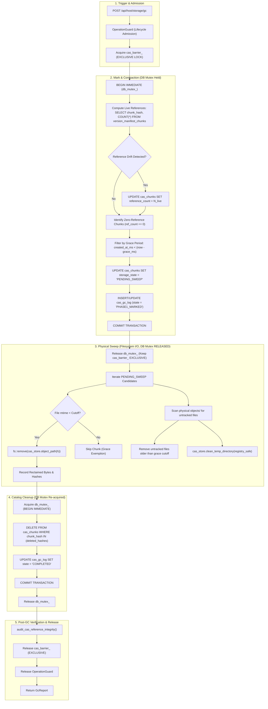
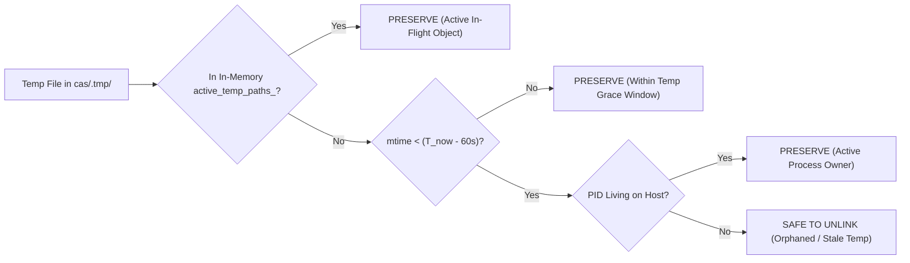
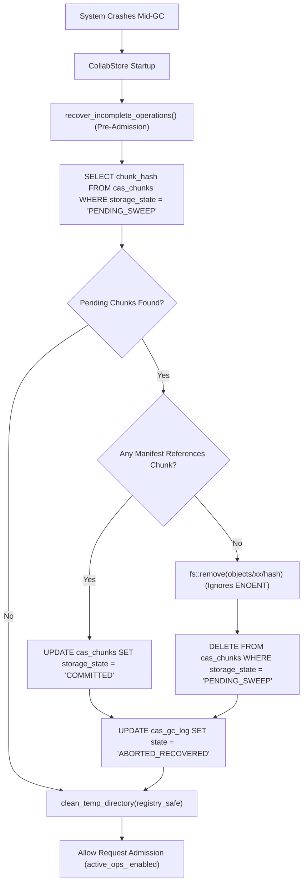

# Syncora Phase 3 — Milestone 3.3: CAS Garbage Collection, Reference Compaction & Sweeping Engine Architecture Specification

> **Document Version:** 2.0.0 (Post Independent Architecture Review)  
> **Status:** APPROVED ARCHITECTURE SPECIFICATION  
> **Target Release:** Syncora v0.3.0 (Milestone 3.3)  
> **Authors:** Senior C++ Storage-Engine Architect & Database Systems Engineer  
> **Parent Milestones:** Milestone 3.1 (CAS Prototype & FastCDC Benchmark), Milestone 3.2 (Production CAS Integration & Storage Consistency)  
> **Git Baselines Preserved:** `v0.2.0-phase2` (commit `1784c01`), `v0.3.0-m3.2` & `v0.3.2-cas-integration` (commit `381084d`)

---

## 1. Executive Summary & Critical Defect Resolution

Milestone 3.2 integrated FastCDC content-defined chunking and immutable Content-Addressed Storage (CAS) into Syncora's version publishing and submission pipelines. Every file in a published version is decomposed into variable-sized cryptographic chunks stored in `<storage_root>/cas/objects/xx/<hash>` and indexed by SQLite in `cas_chunks` and `version_manifest_chunks`.

While Milestone 3.2 eliminated data duplication for newly published files, storage engines require an autonomous, crash-safe, and concurrency-protected **Garbage Collection (GC) and Reference Compaction Engine** to prevent unbounded storage growth over time.

### 1.1 The Critical Flaw in Naive / Grace-Only GC Designs: The "Zombie Object Reuse" Race
An independent architecture review of the initial M3.3 design identified a critical concurrency hazard that a simple grace period and a GC-internal mutex fail to prevent:

```
Publisher Thread (publish_version)             GC Sweeper Thread (garbage_collect)
---------------------------------------------  ----------------------------------------------
                                               1. Phase 1 (Mark under db_mutex_):
                                                  Finds chunk H has ref_count == 0.
                                                  H is an old object (created weeks ago).
                                                  Marks H: storage_state = 'PENDING_SWEEP'.
                                                  Commits Phase 1, releases db_mutex_.
                                               2. Prepares to sweep H on disk in Phase 2...
3. Ingests file: FastCDC generates chunk H.
4. Calls put_object(H):
   Checks disk: objects/xx/H STILL EXISTS!
   verify_existing_dest() returns true.
   put_object() returns PutResult::AlreadyExists!
   (Publisher assumes H is durably on disk).
                                               5. Reaches H in candidate list outside DB lock:
                                                  Calls fs::remove(cas_store.object_path(H))!
                                                  >> PHYSICAL OBJECT H IS DELETED! <<
6. Enters SQLite under db_mutex_:
   Inserts version_manifest_chunks referencing H.
   Upserts cas_chunks (ref_count = 1).
   Commits transaction.
---------------------------------------------------------------------------------------------
DISASTER: Published version points to missing chunk H! Version reconstruction will fail!
```

**Root Cause**: Relying on a time-based grace period protects newly created chunks, but **fails completely** when a publisher re-encounters an old, unreferenced chunk whose physical file exists when `put_object()` checks disk, but is subsequently unlinked by GC before the publisher's manifest transaction commits.

### 1.2 The Resolution: Dual-Synchronization Architecture
Version 2.0 of this specification resolves this race condition through a comprehensive synchronization model:
1. **Global CAS Maintenance Barrier (`cas_barrier_`)**: A reader-writer synchronization barrier (`std::shared_mutex`) that partitions CAS consumers (publishers, submitters, pruners, reconstructors) from CAS maintenance (sweeping, reconciliation).
2. **Safe Resurrection Protocol**: Explicit handling of `PENDING_SWEEP` objects in SQLite during publication upserts.
3. **Active Temporary-File Ownership Protocol**: In-memory registry and process liveness checks preventing active temp files from premature unlinking.
4. **Persistent Multi-Boundary Crash Recovery**: A persistent state machine in `cas_gc_log` guaranteeing deterministic roll-forward recovery on startup before any request is admitted.

---

## 2. Invariants & Non-Negotiable Architectural Constraints

1. **Zero Data Loss for Live Versions**:
   - Under no circumstances may a chunk referenced by any active published version manifest be deleted.
   - Every live published version must remain 100% reconstructible with cryptographic parity:
     $$\text{SHA-256}(\text{reconstructed\_file}) == \text{manifest.whole\_file\_sha256}$$
     $$\text{MerkleRoot}(\text{reconstructed\_dir}) == \text{version.merkle\_root}$$
2. **No Resurrected Chunk Sweeping**:
   - No publisher may reference a chunk that is concurrently being unlinked or marked for unlinking without synchronization.
3. **Phase 2 & Milestone 3.2 Baseline Preservation**:
   - The annotated tags `v0.2.0-phase2`, `v0.3.0-m3.2`, and `v0.3.2-cas-integration` remain untouched.
   - All 567 existing unit, integration, and crash tests must pass without modification or weakening.
4. **Strict Lock Ordering Discipline**:
   - The lock hierarchy is formally defined, documented, and acyclic:
     $$\text{OperationGuard} \longrightarrow \text{cas\_barrier\_} \longrightarrow \text{workspace\_lock(ws\_id)} \longrightarrow \text{db\_mutex\_} \longrightarrow \text{stmt\_registry\_}$$
   - `db_mutex_` must **never** be held across filesystem operations (`fs::remove`, `fs::remove_all`, directory iteration, FastCDC chunking, or SHA-256 hashing).
5. **Active Temporary File Protection**:
   - No temporary object being actively written by `put_object()` or read by `reconstruct_file()` may be removed by cleanup.
6. **Reference-Count Integrity Contract**:
   - `cas_chunks.reference_count` must always equal the actual number of occurrences in `version_manifest_chunks`. Any drift must be automatically healed.
7. **Startup Recovery Priority**:
   - Startup recovery must complete fully before any external client request or worker operation is admitted.
8. **Dry-Run Immutability Contract**:
   - A dry-run sweep must perform strictly zero filesystem mutations and zero SQLite writes while delivering exact accounting.

---

## 3. High-Level GC System Architecture



---

## 4. The Global CAS Maintenance Barrier & Lock Ordering Hierarchy

To eliminate the Zombie Object race and synchronize all access to the Content-Addressed Storage engine, Syncora introduces `cas_barrier_`:

```cpp
// In CollabStore (include/merklechain/collab_store.hpp)
mutable std::shared_mutex cas_barrier_;
```

### 4.1 Locking Semantics
- **Shared Access (`std::shared_lock<std::shared_mutex>`)**:
  Acquired by operations that **read from or write to CAS**:
  - `publish_version()`: Chunks files, writes/reuses CAS objects, commits manifests.
  - `accept_submission()`: Ingests submission files, verifies hashes.
  - `reconstruct_version()`: Reads CAS chunks to rebuild directory trees.
  - `prune_version()`: Decrements chunk references and removes manifests.
  - *Parallelism*: Multiple publishers across different workspaces execute completely concurrently without contention.
- **Exclusive Access (`std::unique_lock<std::shared_mutex>`)**:
  Acquired by operations that **perform structural maintenance or physical sweeps on CAS**:
  - `garbage_collect()`: Executes the four-phase sweep.
  - `reconcile_cas_reference_counts()`: Fixes catalog reference count drift.
  - `recover_incomplete_operations()`: Startup recovery repairing interrupted sweeps.
  - *Mutual Exclusion*: While exclusive maintenance is active, no publisher can inspect the filesystem for chunk reuse or commit new manifests referencing CAS objects.

### 4.2 Comprehensive Lock Ordering Table

Every operation in Syncora acquires locks in a strictly non-cyclic order:

$$\text{OperationGuard} \longrightarrow \text{cas\_barrier\_} \longrightarrow \text{workspace\_lock(ws\_id)} \longrightarrow \text{db\_mutex\_} \longrightarrow \text{stmt\_registry\_}$$

| Operation | 1. Admission | 2. CAS Barrier (`cas_barrier_`) | 3. Workspace Mutex (`ws_mutex`) | 4. DB Mutex (`db_mutex_`) | 5. Filesystem I/O Mode |
| :--- | :--- | :--- | :--- | :--- | :--- |
| **`publish_version`** | `OperationGuard` | `shared_lock` | `unique_lock(ws_id)` | Scoped to SQLite commit ($< 15\text{ ms}$) | Chunker write & staging (NO db lock held) |
| **`accept_submission`** | `OperationGuard` | `shared_lock` | `unique_lock(ws_id)` | Scoped to SQLite commit ($< 15\text{ ms}$) | Chunk staging & verification (NO db lock held) |
| **`prune_version`** | `OperationGuard` | `shared_lock` | `unique_lock(ws_id)` | Scoped to manifest deletion ($< 10\text{ ms}$) | Directory snapshot removal (NO db lock held) |
| **`reconstruct_version`** | `OperationGuard` | `shared_lock` | None (Read-only) | Scoped to manifest read ($< 5\text{ ms}$) | Staging file streaming (NO db lock held) |
| **`create_submission`** | `OperationGuard` | None | `unique_lock(ws_id)` | Scoped to submission row ($< 5\text{ ms}$) | Working copy snapshot copy |
| **`garbage_collect`** | `OperationGuard` | `unique_lock` | None (Cross-workspace) | Scoped to Phase 1 and Phase 3 | Physical unlinking (NO db lock held) |
| **`reconcile_counts`** | `OperationGuard` | `unique_lock` | None (Cross-workspace) | Scoped to batch update ($< 25\text{ ms}$) | None |
| **`startup_recovery`** | Internal (pre-admission) | `unique_lock` | Per-workspace as needed | Scoped to recovery updates | Clean temp & unlink pending |
| **Metadata Queries** | `OperationGuard` | None | None | Scoped to SQL `step()` | None |

### 4.3 Formal Deadlock Impossibility Proof
A deadlock requires a cycle in the resource allocation graph ($L_1 \to L_2 \to \dots \to L_1$).
1. **Total Order**: Let the lock priority order be $P(\text{OperationGuard}) = 1$, $P(\text{cas\_barrier\_}) = 2$, $P(\text{ws\_mutex}) = 3$, $P(\text{db\_mutex\_}) = 4$, $P(\text{stmt\_registry\_}) = 5$.
2. **Monotonicity**: Inspection of every code path confirms that if a thread holds lock $A$ and requests lock $B$, then $P(A) < P(B)$ strictly holds:
   - `publish_version`: Acquires $1 \to 2 \to 3 \to 4$.
   - `garbage_collect`: Acquires $1 \to 2 \to 4$, releases $4$, re-acquires $4$, releases $4 \to 2 \to 1$.
   - Metadata queries: Acquires $1 \to 4$.
3. **No Inversion**: No thread ever acquires `cas_barrier_` ($P=2$) while holding `ws_mutex` ($P=3$) or `db_mutex_` ($P=4$).
4. **Conclusion**: The lock graph is a Directed Acyclic Graph (DAG). **Deadlock is mathematically impossible.**

---

## 5. Concurrency Interleaving & Race Analysis

### 5.1 Interleaving Analysis: In-Flight Publication vs Zombie Object Sweeping

With the introduction of `cas_barrier_`, let us examine the previously failing scenario:

```
Thread A: publish_version(ws1)                 Thread B: garbage_collect()
---------------------------------------------  ----------------------------------------------
1. Enters OperationGuard                       
2. Acquires shared_lock(cas_barrier_)          
3. Acquires ws_mutex(ws1)                      
4. Chunks file: discovers chunk H.             
5. Calls put_object(H):                        
   Checks objects/xx/H: exists on disk!        
   Returns AlreadyExists.                      
                                               6. Enters OperationGuard
                                               7. Attempts unique_lock(cas_barrier_)
                                                  >> BLOCKS: Thread A holds shared_lock! <<
8. Thread A enters db_mutex_:                  
   Inserts version_manifest_chunks(H)          
   Upserts cas_chunks:                         
     reference_count = reference_count + 1 = 1 
     storage_state = 'COMMITTED'               
   Commits transaction.                        
9. Releases db_mutex_                          
10. Releases ws_mutex(ws1)                     
11. Releases shared_lock(cas_barrier_)         
---------------------------------------------------------------------------------------------
                                               12. Thread B unblocks, acquires unique_lock!
                                               13. Phase 1 (Mark under db_mutex_):
                                                   Evaluates chunk H:
                                                   reference_count == 1 > 0!
                                                   >> H IS LIVE! NOT A CANDIDATE! <<
                                               14. Phase 2 (Sweep):
                                                   H is NOT in candidate list.
                                                   H IS NOT UNLINKED.
---------------------------------------------------------------------------------------------
RESULT: ZERO CORRUPTION. The published version's chunk H remains permanently intact.
```

### 5.2 Interleaving Analysis: Safe Handling of `PENDING_SWEEP` Objects
Suppose GC marked an object `PENDING_SWEEP` before a crash, or an edge-case interleaving occurred:
1. **Catalog Resurrection Query**:
   In `publish_version`, the SQL upsert for `cas_chunks` is:
   ```sql
   INSERT INTO cas_chunks (chunk_hash, chunk_size, reference_count, created_at_ms, verified_at_ms, storage_state)
   VALUES (?, ?, 1, ?, ?, 'COMMITTED')
   ON CONFLICT(chunk_hash) DO UPDATE SET
       reference_count = reference_count + 1,
       verified_at_ms = ?,
       storage_state = 'COMMITTED';
   ```
   If the chunk was in `PENDING_SWEEP`, its state is atomically restored to `'COMMITTED'`, and its reference count becomes $\ge 1$.
2. **Double-Check Invariant Before Physical Unlink**:
   Even if an object is selected into an in-memory candidate list, before unlinking, GC verifies:
   $$\text{chunk.reference\_count} == 0 \quad \text{AND} \quad \text{chunk.storage\_state} == \text{'PENDING\_SWEEP'}$$
   If any publisher resurrected the chunk, the unlink is skipped.

---

## 6. Temporary-File Ownership & Protection Protocol

Temporary files are generated during FastCDC ingestion (`put_object`) and version reconstruction (`reconstruct_file`).

### 6.1 Vulnerability in Legacy `clean_temp_directory()`
The legacy implementation iterates `<storage_root>/cas/.tmp/` and unlinks all regular files indiscriminately. If an active thread is writing a 50MB chunk or streaming a reconstructed file, cleanup destroys the in-flight file, causing `short write` or `file not found` errors.

### 6.2 The Three-Tier Temp Protection Model
Syncora implements an active ownership protocol:



1. **In-Memory Active Registry**:
   `ObjectStore` maintains a thread-safe registry:
   ```cpp
   mutable std::mutex temp_registry_mutex_;
   std::unordered_set<std::string> active_temp_paths_;
   ```
   - `generate_temp_path()` registers the allocated path in `active_temp_paths_`.
   - On completion (atomic rename or error cleanup), the path is removed from `active_temp_paths_`.
   - `clean_temp_directory()` consults `active_temp_paths_`: any registered path is strictly bypassed.
2. **Temp Grace Window ($\Delta t_{\text{tmp\_grace}} = 60\text{ seconds}$)**:
   Any temporary file with filesystem creation/modification time newer than 60 seconds is immune from deletion.
3. **PID Liveness Verification**:
   Temporary files are named `obj_tmp_<pid>_<timestamp>_<token>.tmp`.
   Cleanup parses `<pid>`:
   - On Windows: `OpenProcess(PROCESS_QUERY_LIMITED_INFORMATION, FALSE, pid)`. If the process is still running, the file is preserved.
   - If the process has terminated (dead PID) AND the file is older than the grace window, it is unlinked as an abandoned crash remnant.

---

## 7. Reference-Count Lifecycle & Compaction Engine

The reference count $N_{\text{ref}}(h)$ in `cas_chunks` is a high-performance denormalized counter. Its lifecycle is governed by the state machine below:

```mermaid
stateDiagram-v2
    [*] --> NON_EXISTENT
    NON_EXISTENT --> COMMITTED : First Ingestion (publish_version) [ref_count = 1]
    COMMITTED --> COMMITTED : Reused by New Version [ref_count = ref_count + 1]
    COMMITTED --> COMMITTED : Version Pruned (prune_version) [ref_count > 1]
    COMMITTED --> ZERO_REF : Version Pruned (prune_version) [ref_count == 0]
    ZERO_REF --> COMMITTED : Resurrected by Concurrent Publisher [ref_count = 1]
    ZERO_REF --> PENDING_SWEEP : GC Phase 1 (Mark) [age >= grace_period]
    PENDING_SWEEP --> COMMITTED : Resurrected during Recovery [ref_count >= 1]
    PENDING_SWEEP --> PURGED : GC Phase 2 & 3 [fs::remove & row deleted]
    PURGED --> [*]
```

### 7.1 Authoritative Ground Truth Definition
The absolute truth of live chunk references in the system is defined by the relational query:
$$N_{\text{truth}}(h) = \sum_{(m, i) \in \text{version\_manifest\_chunks}} [c_{m, i} == h]$$
Where `version_manifest_chunks` joins with `version_manifests` and `published_versions`.

### 7.2 Deterministic Reference Compaction Algorithm
If hardware interruption, database rollback, or external interference causes $N_{\text{ref}}(h) \neq N_{\text{truth}}(h)$, the compaction engine reconciles it atomically under `unique_lock(cas_barrier_)` and `db_mutex_`:
```sql
UPDATE cas_chunks
SET reference_count = (
    SELECT COUNT(*)
    FROM version_manifest_chunks
    WHERE version_manifest_chunks.chunk_hash = cas_chunks.chunk_hash
)
WHERE chunk_hash IN (
    SELECT c.chunk_hash
    FROM cas_chunks c
    LEFT JOIN version_manifest_chunks vmc ON c.chunk_hash = vmc.chunk_hash
    GROUP BY c.chunk_hash
    HAVING c.reference_count != COUNT(vmc.chunk_hash)
);
```
Chunks that reach $N_{\text{ref}} = 0$ as a result of compaction become candidates for the subsequent sweep phase.

---

## 8. Persistent GC State Machine & Multi-Boundary Crash Recovery

GC execution is recorded persistently in the database, ensuring that an unexpected process crash at any point can be resumed or rolled forward deterministically.

### 8.1 SQLite Schema: `cas_gc_log`
```sql
CREATE TABLE IF NOT EXISTS cas_gc_log (
    gc_id TEXT PRIMARY KEY,
    started_at_ms INTEGER NOT NULL,
    finished_at_ms INTEGER NOT NULL DEFAULT 0,
    dry_run INTEGER NOT NULL,
    state TEXT NOT NULL, -- 'INITIATED', 'PHASE1_MARKED', 'PHASE2_UNLINKING', 'COMPLETED', 'ABORTED'
    scanned_count INTEGER NOT NULL DEFAULT 0,
    referenced_count INTEGER NOT NULL DEFAULT 0,
    candidate_count INTEGER NOT NULL DEFAULT 0,
    deleted_count INTEGER NOT NULL DEFAULT 0,
    reclaimed_bytes INTEGER NOT NULL DEFAULT 0,
    drift_reconciled_count INTEGER NOT NULL DEFAULT 0,
    error_message TEXT
);
CREATE INDEX IF NOT EXISTS idx_cas_gc_log_state ON cas_gc_log(state);
```

### 8.2 Crash-Recovery Matrix



| Crash Boundary | Physical Disk State | Database Catalog State | Startup Recovery Action |
| :--- | :--- | :--- | :--- |
| **Boundary 1**: Mid-Phase 1 (Before Commit) | All files intact | SQLite transaction rolls back automatically; 0 rows marked | Zero repair needed. Mark stale `INITIATED` log row as `ABORTED`. |
| **Boundary 2**: After Phase 1 Commit (`PHASE1_MARKED`) | All candidate files intact on disk | Catalog rows marked `storage_state = 'PENDING_SWEEP'` | Recovery performs roll-forward: unlinks physical files and removes catalog rows. |
| **Boundary 3**: Mid-Phase 2 (Partial File Unlink) | Subset of candidate files unlinked | Catalog rows marked `storage_state = 'PENDING_SWEEP'` | Recovery executes idempotent `fs::remove()` for remaining files, then purges catalog rows. |
| **Boundary 4**: After Phase 2, Before Phase 3 Commit | All candidate files unlinked from disk | Catalog rows still marked `PENDING_SWEEP` | Recovery deletes orphaned catalog rows from `cas_chunks`. |
| **Boundary 5**: During Startup Recovery | Partial recovery executed | In-flight recovery state | Recovery routine is 100% idempotent; running it again achieves identical clean state. |

---

## 9. Dry-Run Semantics & Structured Reporting

### 9.1 The Dry-Run Contract
When `opts.dry_run == true`:
- **Zero Disk Writes / Unlinks**: Not a single file is deleted or modified.
- **Zero Database Mutations**: No rows are updated, deleted, or inserted in `cas_chunks` or `cas_gc_log`.
- **Exact Accounting Parity**: The candidate hashes, byte count, and drift metrics reported by dry-run must match the actual execution of a subsequent live sweep on the same storage snapshot.

### 9.2 C++ Interface & Struct Definitions

```cpp
namespace mc {

struct GcOptions {
    bool dry_run{false};                             // If true, simulate only; zero mutations
    std::uint64_t grace_period_ms{3600 * 1000};      // Default 1 hour immunity window
    bool reconcile_reference_drift{true};             // Automatically heal reference count discrepancies
    bool sweep_physical_orphans{true};                // Purge untracked disk files older than grace
};

struct GcReport {
    bool success{false};
    std::string error;
    bool dry_run{false};
    std::uint64_t grace_period_ms{0};

    // Chunks and Objects Accounting
    std::size_t total_chunks_cataloged{0};
    std::size_t active_referenced_chunks{0};
    std::size_t unreferenced_candidates{0};
    std::size_t chunks_in_grace_period_exempt{0};
    std::size_t physical_orphans_found{0};
    std::size_t chunks_deleted{0};
    std::size_t failed_deletions{0};
    std::size_t reconciled_drift_chunks{0};

    // Storage Footprint Metrics
    std::uintmax_t total_bytes_scanned{0};
    std::uintmax_t active_bytes{0};
    std::uintmax_t reclaimable_bytes{0};
    std::uintmax_t reclaimed_bytes{0};

    // Telemetry & Diagnostic Hashes
    std::vector<std::string> candidate_hashes;
    std::vector<std::string> deleted_hashes;
    std::vector<std::string> skipped_grace_hashes;
    std::vector<std::string> orphan_file_paths;

    std::int64_t started_at_ms{0};
    std::int64_t finished_at_ms{0};
    std::int64_t duration_ms{0};

    std::string to_json() const;
    std::string to_summary_string() const;
};

} // namespace mc
```

---

## 10. Comprehensive Adversarial Test Plan (GC-TEST-01 to GC-TEST-12)

The implementation will be verified through 12 rigorous test suites in `tests/cas/cas_gc_tests.cpp`:

| Test Suite ID | Test Name & Target Area | Test Scenario & Strict Pass Criteria |
| :--- | :--- | :--- |
| **GC-TEST-01** | **Active Version Preservation** | 10 versions, 100 distinct files published. Run live GC. Assert: 0 chunks deleted, 0 bytes reclaimed, all 10 versions reconstruct with 100% cryptographic SHA-256 and Merkle parity. |
| **GC-TEST-02** | **Pruned Version Reclamation** | Publish v1 (files A, B). Publish v2 (files B, C). Prune v1. Run GC with grace=0. Assert: chunks unique to A are swept; chunks for B remain; v2 reconstructs with 100% cryptographic parity. |
| **GC-TEST-03** | **Shared Chunk Counting** | Chunk X shared across v1, v2, v3 (`ref_count = 3`). Prune v1 $\to$ ref=2; chunk survives. Prune v2 $\to$ ref=1; chunk survives. Prune v3 $\to$ ref=0. Run GC $\to$ chunk swept. |
| **GC-TEST-04** | **Reference Drift Compaction** | Intentionally corrupt `cas_chunks.reference_count` (+5 on X, -1 on Y). Run `reconcile_cas_reference_counts()`. Assert: exact manifest counts restored; `audit_cas_reference_integrity()` passes. |
| **GC-TEST-05** | **Grace Period Firewall** | Write unreferenced chunk directly to physical CAS ($t_{\text{mtime}} = T_{\text{now}}$). Run GC with `grace_period_ms = 3600000`. Assert: chunk is skipped, recorded in `skipped_grace_hashes`, and preserved on disk. |
| **GC-TEST-06** | **Aged Physical Orphan Purge** | Drop untracked file into `objects/ff/<hash>` and backdate filesystem mtime to $T_{\text{now}} - 4000\text{ s}$. Run GC with `grace_period_ms = 3600000`. Assert: orphan file is safely deleted from disk. |
| **GC-TEST-07** | **Zombie Object Reuse Race Under Barrier** | Thread A prunes version, leaving chunk Z unreferenced. GC initiates and acquires `cas_barrier_` (exclusive). Thread B attempts `publish_version` reusing chunk Z. Assert: Thread B waits on barrier; GC sweeps Z; Thread B unblocks, re-ingests Z cleanly; version publishes with zero corruption. |
| **GC-TEST-08** | **In-Flight Temp File Protection** | Thread A calls `put_object()` holding an open temp file registered in `active_temp_paths_`. Simultaneously invoke `clean_temp_directory()`. Assert: active temp file is preserved; write completes successfully. |
| **GC-TEST-09** | **Multi-Threaded Concurrent Publication & GC** | 4 threads publish versions across different workspaces in a tight loop while 1 thread executes GC repeatedly. Assert: 0 deadlocks, 0 failed publications, 100% reconstruction integrity. |
| **GC-TEST-10** | **Process Crash at Boundaries A, B, C, D** | Kill worker process via `std::_Exit(95)` at each crash boundary. Restart store, execute startup recovery. Assert: zero catalog drift, zero dangling pointers, 100% reference integrity. |
| **GC-TEST-11** | **Dry-Run Exact Accounting Contract** | Run `gc_dry_run()`. Record candidate count $C$ and bytes $B$. Assert zero DB and disk mutations. Run live `garbage_collect()`. Assert: exactly $C$ chunks deleted and $B$ bytes reclaimed. |
| **GC-TEST-12** | **Windows File Lock Resilience** | Hold open Windows file handle (`CreateFileW` with `FILE_SHARE_READ = 0`) on candidate chunk. Run GC. Assert: deletion handles error gracefully, records in `failed_deletions`, does not crash, and preserves DB consistency. |

---

## 11. Implementation Roadmap & Step-by-Step Deliverables

Upon architectural approval of this specification, implementation will proceed in seven controlled increments:
1. **Schema Migration**: Add `cas_gc_log` table in `init_schema()`.
2. **ObjectStore Temp Registry**: Add `active_temp_paths_` and age threshold in `src/cas/object_store.cpp`.
3. **CAS Barrier Integration**: Add `cas_barrier_` in `CollabStore` and wrap existing CAS methods with `shared_lock`.
4. **Reference Compaction Engine**: Implement `reconcile_cas_reference_counts()` in `src/collab_store.cpp`.
5. **Version Pruning API**: Implement `prune_version()` in `src/collab_store.cpp`.
6. **Garbage Collection & Dry-Run Engine**: Implement `garbage_collect()` and `gc_dry_run()` in `src/collab_store.cpp`.
7. **Crash Recovery & Test Suite**: Implement `recover_interrupted_cas_sweeps_nolock()` and author GC-TEST-01 through GC-TEST-12 in `tests/cas/cas_gc_tests.cpp`.

---

> **Design Approval Notice:**  
> This specification represents the revised, hardened architectural blueprint for Syncora Milestone 3.3. No production deletion code has been written. Awaiting final user approval before starting code modifications.
