# Syncora Security Audit Report — SEC-05 Final Remediation & Verification

**Document Version:** 1.0  
**Target Milestone:** Milestone 3.4 (Distributed CAS Delta Network Synchronization)  
**Target Commit:** `1d4ba0d88e49c43c0655c72c8a7c42d8c3b3ecf0`  
**Security Finding ID:** SEC-05  
**Severity:** High  
**Subsystem:** Content-Addressed Storage (CAS) Interprocess Maintenance Barrier  
**Primary Header:** `include/merklechain/cas/interprocess_barrier.hpp`  
**Test Suite:** `tests/peer_cas_helpers_tests.cpp` (Section 13: Tests 13.1 – 13.15)  
**Status:** **REMEDIATED AND VERIFIED**

---

## 1. Executive Summary

During the project-wide security audit and post-remediation analysis of Syncora Milestone 3.4, finding **SEC-05** identified a critical weakness in the inter-process concurrency boundary:

In `mc::cas::InterprocessCasBarrier`, if an operating system file unlock syscall (`::UnlockFileEx` on Windows or `::flock(fd, LOCK_UN)` on POSIX) encountered a failure, the return value was ignored and the user-space flag `os_lock_acquired_` was unconditionally set to `false`. If the underlying kernel retained the lock (or if the file descriptor/handle table entry became desynchronized), the running process would assume it no longer held the lock, while subsequent acquisitions on the same instance could either bypass concurrency guarantees or leave the process in an inconsistent, corrupt state. Furthermore, unlock operations are called during RAII guard destruction and stack unwinding, where throwing exceptions would cause process termination via `std::terminate()`.

This report documents the completed, fail-closed remediation and comprehensive test verification of **SEC-05**.

### Key Architectural Resolutions
1. **Preservation of `noexcept` Destruction:** Unlock methods (`unlock_shared()` and `unlock_exclusive()`) remain strictly `noexcept`, preventing fatal `std::terminate()` aborts during stack unwinding.
2. **Fail-Closed Poisoning:** Any OS unlock syscall failure transitions the `InterprocessCasBarrier` instance into a permanent, poisoned state (`is_poisoned_ = true`).
3. **Lock Retention Mirroring:** On unlock failure, `os_lock_acquired_` **remains `true`**, accurately mirroring the fact that the OS kernel has not released the underlying byte-range/flock lock.
4. **Subsequent Call Rejection:** All subsequent shared or exclusive acquisition attempts (`lock_shared()`, `try_lock_shared()`, `lock_exclusive()`, `try_lock_exclusive()`) immediately fail closed by throwing a typed `mc::cas::InterprocessLockException` with status `BarrierLockStatus::OperatingSystemError` or returning `OperatingSystemError`.
5. **Local State Consistency & Deadlock Prevention:** Calling thread depth and reader counters are decremented, and `in_proc_mutex_` is unlocked, ensuring no thread is permanently blocked waiting on an in-process lock.
6. **Kernel Lock Release via Handle Closure:** In `close_file()` and `~InterprocessCasBarrier()`, closing the OS file handle (`CloseHandle` / `close`) guarantees that the kernel handle table purges all associated file locks, cleanly freeing the lock for competing processes.
7. **Comprehensive Diagnostics:** Real-time diagnostics are exposed via `is_poisoned()`, `poison_reason()`, `last_unlock_error()`, and `format_os_error_message()`.

---

## 2. Exact Source Locations & Architecture Changes

### 2.1 Header: `include/merklechain/cas/interprocess_barrier.hpp`

| Symbol / Method | Line Range | Role and Fail-Closed Behavior |
| :--- | :--- | :--- |
| `BarrierFaultPoint::SimulateSyscallUnlockFailure` | Lines 56–63 | Added fault-injection enumerator allowing test harnesses to deterministically trigger simulated OS-level unlock syscall failures (`UnlockFileEx` returning `FALSE`, `flock` returning `-1`). |
| `InterprocessCasBarrier::is_poisoned()` | Lines 308–315 | Thread-safe query returning whether the barrier instance has encountered an unlock failure and is poisoned. |
| `InterprocessCasBarrier::poison_reason()` | Lines 317–324 | Thread-safe diagnostic accessor returning detailed OS error context. |
| `InterprocessCasBarrier::last_unlock_error()` | Lines 326–333 | Thread-safe accessor returning the raw OS error code (`GetLastError()` on Windows, `errno` on POSIX). |
| `InterprocessCasBarrier::format_os_error_message()` | Lines 335–365 | Public static utility converting OS error codes into human-readable strings via Win32 `FormatMessageA` or POSIX `std::strerror`. |
| `InterprocessCasBarrier::close_file()` | Lines 367–385 | Public, `noexcept`, idempotent method closing the underlying OS handle/fd. On Windows, `::CloseHandle` automatically purges byte-range locks retained by the kernel handle table; on POSIX, `::close(fd)` releases flock locks. |
| `InterprocessCasBarrier::lock_shared()` | Lines 116–161 | Checks `is_poisoned_` both before acquisition and under `os_mutex_`. If poisoned, immediately unwinds in-process locks and throws `InterprocessLockException`. |
| `InterprocessCasBarrier::try_lock_shared()` | Lines 163–208 | Checks `is_poisoned_`; returns `BarrierLockStatus::OperatingSystemError` without acquiring any locks. |
| `InterprocessCasBarrier::lock_exclusive()` | Lines 228–261 | Checks `is_poisoned_`; if poisoned, throws `InterprocessLockException` with detailed poison reason. |
| `InterprocessCasBarrier::try_lock_exclusive()` | Lines 263–295 | Checks `is_poisoned_`; if poisoned, returns `BarrierLockStatus::OperatingSystemError`. |
| `InterprocessCasBarrier::release_os_lock_unlocked()` | Lines 575–630 | Inspects OS syscall return values. If unlock fails: marks `is_poisoned_ = true`, records OS error in `last_unlock_error_` and `poison_reason_`, and **leaves `os_lock_acquired_ = true`**. |

### 2.2 Test Suite: `tests/peer_cas_helpers_tests.cpp`

Section 13 was expanded to include 15 deterministic barrier tests (tests 13.1 through 13.15), spanning 201 lines of unit verification code.

---

## 3. Platform Failure Semantics: Windows vs. POSIX

### 3.1 Windows (`::UnlockFileEx`)
* **Syscall Signature:**
  ```cpp
  BOOL UnlockFileEx(
      HANDLE       hFile,
      DWORD        dwReserved,
      DWORD        nNumberOfBytesToUnlockLow,
      DWORD        nNumberOfBytesToUnlockHigh,
      LPOVERLAPPED lpOverlapped
  );
  ```
* **Success / Failure Semantics:** Returns non-zero `BOOL` on success; returns `0` (`FALSE`) on failure. On failure, error details are retrieved via `::GetLastError()`.
* **Failure Modes:**
  - `ERROR_NOT_LOCKED` (158): Attempted to unlock a range not currently locked by this handle.
  - `ERROR_INVALID_HANDLE` (6): The handle table entry was invalidated or closed asynchronously.
  - `ERROR_ACCESS_DENIED` (5) or handle corruption.
* **Kernel State on Failure:** The Windows Executive kernel retains the locked byte range in the file object's byte-range table. Any other process attempting to acquire the byte range receives `ERROR_LOCK_VIOLATION` (33) and is blocked.
* **Cleanup Mechanism:** When `::CloseHandle(file_handle_)` is called or when the process exits, the Windows Object Manager automatically purges all byte-range locks associated with that handle, guaranteeing that orphaned locks do not survive handle closure.

### 3.2 POSIX (`::flock(fd, LOCK_UN)`)
* **Syscall Signature:**
  ```c
  int flock(int fd, int operation); // operation = LOCK_UN
  ```
* **Success / Failure Semantics:** Returns `0` on success; returns `-1` on error. Error code is set in `errno`.
* **Failure Modes:**
  - `EBADF`: `fd` is not an open file descriptor.
  - `EINTR`: Syscall interrupted by a signal handler before lock release completed.
  - `EINVAL`: Invalid operation flag.
  - `ENOLCK`: Kernel lock table exhausted.
* **Kernel State on Failure:** The lock remains registered on the open file description (`struct file` in Linux VFS). Competing processes calling `flock(fd, LOCK_EX | LOCK_NB)` receive `EWOULDBLOCK` / `EAGAIN`.
* **Cleanup Mechanism:** When `close(fd)` is called or the process terminates, all BSD flock locks associated with that open file description are released by the VFS kernel layer.

---

## 4. State Transitions: Before vs. After Remediation

```mermaid
flowchart TD
    subgraph Before["Vulnerable State Machine (Before)"]
        B1["unlock_shared() / unlock_exclusive()"] --> B2["Call OS Unlock Syscall"]
        B2 -->|Syscall Fails| B3["Ignore Error Code"]
        B3 --> B4["Set os_lock_acquired_ = false"]
        B4 --> B5["Subsequent lock() attempts allowed to proceed"]
        B5 --> B6["CRITICAL: Inconsistent State & Corruption Risk"]
    end

    subgraph After["Hardened Fail-Closed State Machine (After)"]
        A1["unlock_shared() / unlock_exclusive()"] --> A2["Call OS Unlock Syscall"]
        A2 -->|Syscall Fails| A3["Capture GetLastError() / errno"]
        A3 --> A4["is_poisoned_ = true<br/>poison_reason_ recorded"]
        A4 --> A5["os_lock_acquired_ REMAINS true<br/>(Reflects Kernel State)"]
        A5 --> A6["In-process counters & mutex unwound safely<br/>(Prevents Deadlock)"]
        A6 --> A7["Subsequent lock() calls REJECTED<br/>(Throw InterprocessLockException)"]
        A7 --> A8["close_file() / Destructor releases kernel lock<br/>via CloseHandle / close"]
    end
```



### Detailed Transition Matrix

| State Component | Before Remediation | After Remediation |
| :--- | :--- | :--- |
| **`os_lock_acquired_` on unlock failure** | Set to `false` (incorrect) | **Remains `true`** (accurately reflects kernel retention) |
| **Barrier health status** | Implicitly considered healthy | **`is_poisoned_ = true`** (permanent fail-closed status) |
| **Diagnostic error recording** | Discarded | **`last_unlock_error_` + `poison_reason_`** stored |
| **Subsequent `lock_shared()`** | Permitted (unsafe) | **Throws `InterprocessLockException`** |
| **Subsequent `try_lock_shared()`** | Permitted (unsafe) | **Returns `BarrierLockStatus::OperatingSystemError`** |
| **Subsequent `lock_exclusive()`** | Permitted (unsafe) | **Throws `InterprocessLockException`** |
| **Subsequent `try_lock_exclusive()`** | Permitted (unsafe) | **Returns `BarrierLockStatus::OperatingSystemError`** |
| **In-process calling thread state** | Unwound, but mutex state desynced | **Cleanly unwound, in-process mutex released** |
| **Resource cleanup on destruction** | None / unsafe retry | **`close_file()` idempotent; releases kernel lock via `CloseHandle`** |

---

## 5. Empirical Test Verification Matrix

The test suite in `tests/peer_cas_helpers_tests.cpp` was executed to verify all 8 required scenarios:

| Test ID | Test Scenario | Verified Invariant | Result |
| :--- | :--- | :--- | :--- |
| **13.8** | **Simulated Shared Unlock Failure** | `FailUnlock` fault injected on `unlock_shared()`. Verified `is_poisoned()` is true, `os_lock_acquired_` remains true, and `poison_reason()` contains diagnostic details. | **PASS** |
| **13.9** | **Simulated Syscall Unlock Failure** | `SimulateSyscallUnlockFailure` injected on `unlock_exclusive()`. Verified raw OS error code captured (`last_unlock_error() != 0`), `is_poisoned() = true`, `os_lock_acquired_ = true`. | **PASS** |
| **13.10** | **Subsequent Shared Acquisition Rejection** | Calling `lock_shared()` on poisoned barrier throws `InterprocessLockException` with status `OperatingSystemError` and mentions poison state. Calling `try_lock_shared()` immediately returns `OperatingSystemError`. | **PASS** |
| **13.11** | **Subsequent Exclusive Acquisition Rejection** | Calling `lock_exclusive()` on poisoned barrier throws `InterprocessLockException`. Calling `try_lock_exclusive()` returns `OperatingSystemError`. | **PASS** |
| **13.12** | **Concurrent Readers & Final Reader Unlock Failure** | Thread 1 and Thread 2 acquire shared locks. Thread 1 releases under normal conditions (reader count drops to 1, no syscall, barrier remains healthy). Final reader (Thread 2) encounters simulated unlock syscall failure. Barrier becomes poisoned. Thread 3 attempts `lock_shared()` and is immediately rejected with an exception without deadlocking. | **PASS** |
| **13.13** | **Repeated Cleanup & Destructor Safety** | Explicitly calling `barrier.close_file()` multiple times on a poisoned barrier is idempotent and `noexcept`. Destructor completes cleanly without throwing or double-closing handles. | **PASS** |
| **13.14** | **Separate Barrier Contention & Release on Close** | `barrier1` acquires exclusive lock; unlock encounters syscall failure. `barrier2` (independent instance on same lock file) attempts `try_lock_exclusive()` and is rejected with `Contended` because the OS kernel still holds the lock. Upon destroying `barrier1` (`CloseHandle`), the kernel releases the lock, and `barrier2` successfully acquires the lock. | **PASS** |
| **13.15** | **Diagnostic Error Formatting** | Verified `format_os_error_message(0)` outputs `"no OS error recorded"`, and non-zero OS error codes output meaningful diagnostic descriptions with error numbers. | **PASS** |

### Complete Regression Test Matrix Results

```
==========================================================
 MerkleChain Test Suite Automation Runner
==========================================================
[*] Launching test suite: build/tests.exe
...
Test checks: 928 passed, 0 failed, 1 skipped
[SUCCESS] All executed tests passed in 57.19s (928 passed, 1 skipped). (Exit Code: 0)

1. Collaboration E2E Test Suite:
   tests/test_collaboration_e2e.ps1: 34 passed, 0 failed (100%)
2. Peer Network Dashboard Tests:
   tests/peer_dashboard_tests.ps1: 71 assertions passed, 0 failed (100%)
3. Dashboard Smoke Tests:
   tests/dashboard_smoke.ps1: PASSED (100%)
4. Selective Sync & Explorer Tests:
   tests/test_selective_sync_and_explorer.ps1: PASSED (100%)
5. Dashboard Navigation JavaScript Suite:
   tests/test_dashboard_navigation.js: 33 routes verified, all passed (100%)
6. CAS Network Protocol Benchmark:
   build/cas_network_benchmark.exe: Up to 99.8% wire bandwidth reduction, all passed (100%)
```

---

## 6. Git & Repository Invariant Verification

Before and after the remediation and verification passes, all Git release invariants were inspected and verified:

```
HEAD: 1d4ba0d88e49c43c0655c72c8a7c42d8c3b3ecf0

Peeled Release Commit References:
  v0.2.0-phase2^{}          = 1784c0113c01aaba2731a2dfb942c7abc8d83582  [MATCH]
  v0.3.0-m3.2^{}            = 381084d29416043b5bbcb196923242cc73435e94  [MATCH]
  v0.3.2-cas-integration^{} = 381084d29416043b5bbcb196923242cc73435e94  [MATCH]
  v0.3.0-m3.3^{}            = e1ab1b0fd3e923001615fb26a1f004ee800fd687  [MATCH]
  v0.3.0-m3.4^{}            = b31dbfe1341a8b06dd8be2bd03017ff5c1376753  [MATCH]

Working Tree State:
  M include/merklechain/cas/interprocess_barrier.hpp
  M tests/peer_cas_helpers_tests.cpp
 ?? docs/security/SYNCORA_POST_REMEDIATION_VERIFICATION.md
 ?? docs/security/SEC_05_UNLOCK_FAILURE_FINAL_REPORT.md
```

No release tags were moved, modified, or recreated. No commits were pushed to any remote.

---

## 7. Remaining Limitations & Operating Boundaries

1. **Process-Level Lock Reinitialization Requirement:** A poisoned `InterprocessCasBarrier` cannot be rehabilitated in-place. If an OS unlock syscall fails, the calling application or thread must destroy the barrier instance (or close its file handle via `close_file()`) and construct a new instance once operating system transient issues are resolved.
2. **Process Termination Semantics:** In the event of a hard process kill (`SIGKILL` or `TerminateProcess`), user-space destructors do not run; however, because the lock is held in the OS kernel handle table, both Windows and Linux kernels automatically purge all locks on process exit.

---

## 8. Final Verdict

All aspects of security finding **SEC-05** have been systematically analyzed, implemented with fail-closed semantics, verified across 8 unit test scenarios, and validated through the complete regression test matrix.

**REMEDIATED AND VERIFIED**

